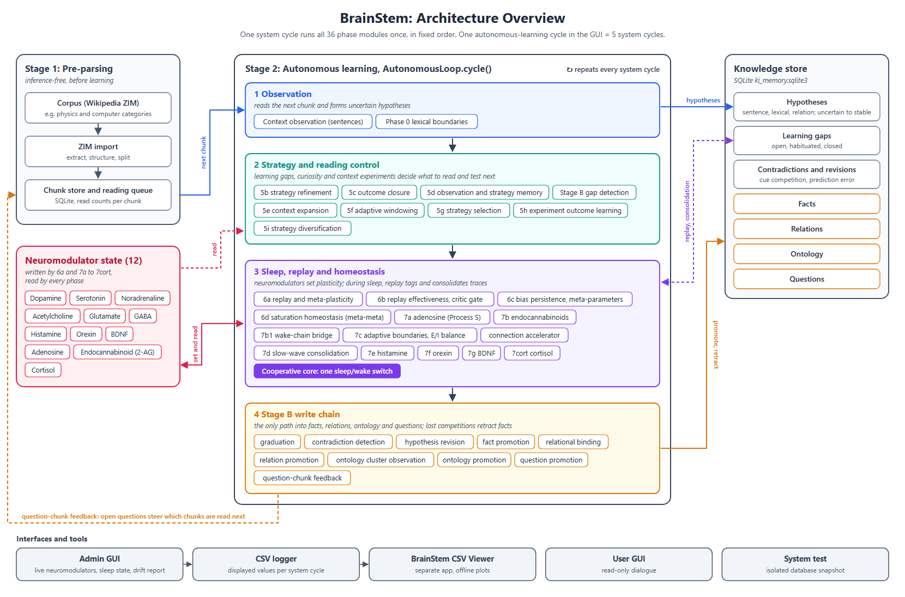
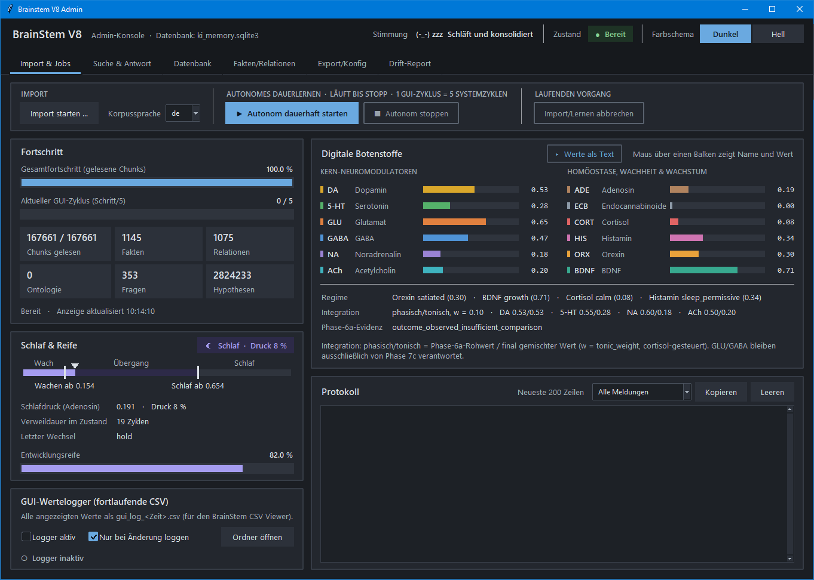

## BrainStem Update 16.11.26

[](#current-state)
[](#running-the-system)
[](#database-and-schema-discipline)
[](#roadmap)

BrainStem is a biologically inspired, Real Neuro-Symbolic (RNS-AI) cognitive architecture for lifelong learning. It starts as a tabula rasa: without any prior knowledge, word lists or grammar, it learns models of the structures and dynamics of text through context hypotheses, uncertainty, competition, prediction error, revision, neuromodulation, sleep replay and consolidation. Early output is expected to be noisy; the system is built to correct itself and to improve over time.

Five observation layers work together: sentence-level context hypotheses, a character-level layer that discovers word boundaries from unsegmented text, a relational layer that binds co-occurring elements, a categorical layer that clusters the relation graph, and a curiosity layer that turns persistent information gaps into questions that steer further reading.

One CPU Core / No GPU

> [!IMPORTANT]
> BrainStem is a research and calibration system, not a production-ready assistant. The productive write paths (facts, relations, ontology categories, questions and their promotion and retraction) are open as an explicitly framed, ongoing experiment. Every promoted artifact remains traceable to, and retractable from, its source hypothesis or gap.

---
[](https://www.youtube.com/watch?v=4nN7zELSAMo)
YouTube - AI conversation about BrainStem Project
---
[NotebookLM codebase exploration](https://notebook.google.com/notebook/34b994eb-9f62-4fd7-a04d-facbd6041654) 24.09.2026
---
### Navigation
- [Current State](#current-state)
- [What is BrainStem really](#what-is-brainstem-really)
- [Roadmap](#roadmap)
- [Architecture](#architecture)
- [Sleep, Replay and Consolidation](#sleep-replay-and-consolidation)
- [Self-Correction: Cue Competition and Prediction Error](#self-correction-cue-competition-and-prediction-error)
- [Emergence Layers](#emergence-layers)
- [Digital Neuromodulator Cockpit](#digital-neuromodulator-cockpit)
- [Neuromodulator-Coupled Thresholds](#neuromodulator-coupled-thresholds)
- [Performance](#performance)
- [Running the System](#running-the-system)
- [ZIM Import](#zim-import)
- [Academic References](#academic-references)
- [Development Notes](#development-notes)

---
### Current State

#### Status as of 16 November 2026

All cycle counts are system cycles; one autonomous-learning cycle in the GUI comprises 5 of them (see [Cycle units](#cycle-units)).

- **Runtime chain:** 36 phase modules plus a log-retention maintenance step and the cycle transaction, loaded by `ki_system/phase_registry.py`. The chain top is the cycle transaction (`v8_cycle_transaction`).
- **Production run (13 November 2026):** 5,000 cycles on the full corpus without exceptions or hidden errors. Stable hypotheses grew from 36 to 2,597, facts from 36 to 819 (101 retracted after lost competitions), relations from 0 to 493; the corpus was read completely and no regulator reached a boundary.
- **Database hygiene and learning fixes (13 November 2026):** the experiment event logs are now kept for the last 1,000 cycles only (a one-time compaction shrinks the 20.5 GB database to 5.8 GB with unchanged lifetime summaries); experiments now report closure when their gap actually closes; replay effectiveness is measured as a cued-versus-uncued contrast; exploration follows learning progress; and ontology categories are stable (10 promotions and 1 retraction in 1,000 cycles, before about 200 of each). A final 1,000-cycle learning run met all nine calibration criteria.
- **Second production run (15 November 2026):** 5,000 cycles on the compacted production database without exceptions or hidden errors. Stable hypotheses grew from 2,597 to 4,505, facts to 1,136 and relations to 1,067, with a capture rate of 97.4 % and no regulator at a boundary. The database grew from 5.8 to 8.1 GB during the first 1,750 cycles and then stayed constant, while the log retention removed 17.5 million old rows. Ontology churn fell to a tenth (110 promotions and 112 retractions, before 1,013 and 1,010), but categories over characters and syllables still dissolve as the relation graph grows.
- **Ontology from words, coexisting memories, faster strategy phases (16 November 2026):** following an advisory council, ontology categories now form only from word-level units, so the ontology stays empty until words are confirmed; two consolidated sentences that share a cue now coexist instead of revising each other; phases 5b and 5d compute their averages with index-backed queries (0.59 to 0.012 s and 0.35 to 0.18 s per cycle, identical values). A 1,000-cycle test run uncovered a savepoint error in the new ontology code, which was fixed; a 200-cycle check afterwards ran without exceptions or diagnostic findings. Details: the project status reports under `docs/`.
- **Half the computation per cycle (16 November 2026):** partial indexes on the gap table let phases 5e, 5f, 5g, 5i, 6a and gap detection read only the about 1,300 active gaps instead of all 276,000 (2.1 s to 0.03 s per cycle, identical results); the process CPU time per cycle fell from about 5.1 to 2.6 s. A 1,000-cycle test run met all nine calibration criteria without exceptions or diagnostic findings. The capture-rate criterion K5 now counts only traces tagged at least 250 cycles before the end of a run, because capture takes a median of 62 and at most about 240 cycles. Details: the project status reports under `docs/`.
- **Sentence frames instead of text contrasts, one commit per cycle (16 November 2026):** following an advisory council, two sentences that differ in one position are stored as a sentence frame with interchangeable fillers, the evidence from which word classes form, and become a contradiction only under strict conditions (see [Sentence frames instead of text contrasts](#sentence-frames-instead-of-text-contrasts)). In an A/B comparison over 1,000 cycles each on identical production copies, the old code added 27,032 unverified contradictions and as many gaps, the new code no contradictions and 36 frame gaps, while learning was at least as good (stable hypotheses +339 against +319, all nine calibration criteria met in both). Each cycle now commits once instead of about 74 times; this writes about a fifth less, while the wall time on the storage pool did not change measurably. A 500-cycle check with both changes ran without exceptions or diagnostic findings. Details: the project status reports under `docs/`.
- **Reproducible learning (16 November 2026):** two learning runs from the same state now end in the same state. Before, two 100-cycle runs from byte-identical copies differed in 101 of 156 tables (4,547 against 4,541 stable hypotheses), because some phases seeded their randomness from the wall clock and some decisions depended on wall-clock seconds. Learning now runs on a learning clock (one tick per cycle) with seeded randomness; two runs with different Python hash seeds and start times are identical in all 157 tables including every timestamp, a run interrupted and restarted equals an uninterrupted one, and a different run seed gives a different replicate. A 1,000-cycle run met all nine calibration criteria. See [Learning clock and reproducibility](#learning-clock-and-reproducibility).
- **Stability check (14 November 2026):** a 1,500-cycle sensory-deprivation run on the compacted production state ended with the verdict "konvergenz": all 21 signals stable or converging, no regulator at a boundary, and consolidation continued without input (stable hypotheses 2,598 to 3,196).
- **All layers learn:** sentence hypotheses, lexical boundaries and relation hypotheses all take part in sleep consolidation and graduate into stable roles. In a 150-cycle run on 300 real Wikipedia chunks the system graduated 35 sentence, 15 lexical-boundary and 35 relation hypotheses and promoted 33 facts, 12 relations and 11 ontology rows.
- **Self-correction works:** consolidated hypotheses compete with alternative completions of the same learned cue. A decisively stronger competitor is treated as a prediction error: the stored hypothesis is reverted to uncertain, its fact is retracted and the hypothesis has to be consolidated again. This happens without any external trigger (example from a test run: cue "April 20", stored evidence 1 vs. competitor evidence 3).
- **Speed:** on the current production state the computation takes about 2.6 s of CPU time per learning cycle (1.2 s on the much smaller state of 13 November); on the storage pool, waiting for the writes adds between under 1 s and about 7 s, so the wall time per cycle fluctuates between about 2 and 10 s (median 2.3 s in the last test run). See [Performance](#performance).
- **Stability:** system test fully green; repeated multi-hundred-cycle runs without exceptions or hidden error states in the nested cycle results.
- **Reading strategies use live state:** phases 5b to 5i take their learning controls (learning rate, error weight, revision, exploration, inhibition, consolidation) and the six core neuromodulators from the live state of Phases 6a and 7c, cluster the real curiosity questions, and read gap resolution from the actual gap status. Phase 5b's exploration and inhibition recommendations act back on the persistent bias state with a damped step (top-down strategy control), counterbalanced by saturation homeostasis (6d) and the endocannabinoid pull (7b).
- **One sleep trigger, developmental sleep share:** a single sleep/wake switch decides when the system sleeps. Adenosine (Process S) rises with the encoding load of each cycle and falls during sleep; sleep starts at an upper and ends at a lower threshold. Like a newborn, the immature system builds up sleep pressure faster and sleeps about two thirds of the time; as consolidated knowledge grows, wake episodes lengthen toward the adult rhythm of about 55 wake and 22 sleep cycles (about 28% sleep). In a 400-cycle run from a fresh database the system slept 62% of the time and graduated 231 hypotheses (103 with a fixed adult rhythm); only 3 of 275 tagged survivors expired before consolidation.
- **Neuromodulators carry the learning state:** dopamine is a reward prediction error (bursts on unexpected success, dips below baseline when an expected reward is missing), noradrenaline adds surprise to the persistent pressure, serotonin follows the long-run average reward, and noradrenaline, acetylcholine and serotonin drop during sleep. The plasticity chain is fully active: replay effectiveness adjusts plasticity and biases, 16 meta parameters regulate themselves with a homeostatic restoring force, meta-meta-plasticity adapts their learning rates, and in a 400-cycle run no regulator reached a boundary.
- **Cortisol Stage 2** is active (guarded soft regulator; per-value cap 0.01, per-cycle budget 0.03, 3-cycle cooldown).

#### Production database

The production database `ki_memory.sqlite3` holds the German Wikipedia categories _Physics_ and _Computer_ (2 documents, 167,661 chunks). Since the last corpus-preserving learning reset, about 6,950 learning cycles have run and all chunks have been read. The production run left it at 20.5 GB, mostly old experiment event logs. On 14 November 2026 a one-time compaction (`python -m ki_system.compact_logs`) brought it down to 5.8 GB, with all learned content and lifetime summaries unchanged; after the second production run it holds 8.1 GB, and its size stays constant under the log retention. Every fact, relation and stable hypothesis traces back to its source chunk.

#### Earlier validation (September 2026)

A full read-through of the corpus and more than 11,500 learning cycles ran without data loss or corruption. A 1,500-cycle sensory-deprivation drift run (input disabled, inner dynamics only) ended with the overall verdict **"konvergiert"**: all 20 evaluated signals were stable or converging, none divergent.

---
### Next Major Steps
- Ontology from sentence frames: once words are confirmed, form categories from fillers that share at least two frames across different articles, instead of co-occurrence; use syllable classes to support word segmentation.
- Benchmark protocol: now that runs are reproducible, compare variants over at least five run seeds each (same seeds for both), with criteria fixed in advance and paired differences with intervals (Henderson et al. 2018; Bouthillier et al. 2021).
- Watch the learning rate: its spread over a run has narrowed to about 0.010 to 0.012, close to the calibration bound of 0.01.
- Content-weighted maturity: observe the shadow value over several runs before coupling it to the sleep rhythm.
- Observe the reward prediction error, learning progress and meta-parameter regulation over a long production run, and how the closure signal develops as more gaps are resolved.
- Later, without priority: reduce the write load of about 50 MB per cycle (measured on 16 November 2026: 43 % from the Phase-0 transition counts, regular peaks from the batched decay of attention scores). An advisory council recommends a WITHOUT ROWID transition table, checkpoints at cycle boundaries every few cycles and two partial indexes (about 30 % fewer writes). This saves SSD wear but no measurable time, so it waits behind changes that make cycles faster.
- Catastrophic-forgetting test (Tadros/Bazhenov motivated): import a second, topically distinct corpus and measure whether already consolidated knowledge is protected, degraded or reinforced.

---
### Roadmap

<table>
<tr><th>Stage</th><th>Status</th><th>Gating condition to proceed</th></tr>
<tr><td>**Stage A: Core stability**</td><td>Complete: full corpus read-through, 11,500+ cycles, 1,500-cycle drift run "konvergiert"</td><td>Complete</td></tr>
<tr><td>**Stage B: Guarded graduation**</td><td>Active for all three eligible roles (sentence, lexical boundary, relation), neuromodulator-coupled role selection</td><td>Ongoing observation</td></tr>
<tr><td>**Sleep/wake switch**</td><td>Active: one switch with hysteresis, adenosine driven by encoding load, thresholds shifted by arousal and inhibition</td><td>Long-run observation on the production corpus</td></tr>
<tr><td>**Prioritized sleep replay**</td><td>Active: three replay tracks with neuromodulated capacity, tagged and random sampling, per-population down-selection</td><td>Long-run observation on the production corpus</td></tr>
<tr><td>**Self-correction (cue competition)**</td><td>Active: learned partial cues, evidence-decided competition, revision, fact retraction, reconsolidation requirement</td><td>Long-run observation on the production corpus</td></tr>
<tr><td>**Lexical emergence (Phase 0)**</td><td>Active, takes part in consolidation and graduation with its own replay quota</td><td>Calibration of context length and entropy threshold</td></tr>
<tr><td>**Relations emergence (Module A)**</td><td>Active and productive</td><td>Observation at production scale</td></tr>
<tr><td>**Ontology emergence (Module B)**</td><td>Active, word-gated (empty until word units are confirmed)</td><td>Categories from sentence positions</td></tr>
<tr><td>**Questions emergence (Module C)**</td><td>Active and productive, including curiosity-directed reading</td><td>Observation at production scale</td></tr>
<tr><td>**Full corpus scaling** (complete German Wikipedia)</td><td>Deliberately deferred</td><td>Order-of-magnitude estimate only</td></tr>
<tr><td>**Vector database evaluation**</td><td>Deliberately deferred</td><td>Only once stable hypothesis identities exist, a concrete semantic-retrieval use case is identified, and a shadow comparison against the SQLite baseline is performed</td></tr>
<tr><td>**Symbolic reasoning plugin** (deterministic, non-LLM rule engine)</td><td>Concept documented, not scheduled</td><td>Gated behind Stage-B graduation; a validated rule becoming productive must be gated at least as strictly as fact promotion</td></tr>
<tr><td>**Multi-core / multi-process learning**</td><td>Out of scope for now</td><td>Not planned</td></tr>
</table>

---
### Core Philosophy

Traditional semantic systems focus on the **what**: storing and retrieving content. BrainStem focuses on the **how**: learning how context, uncertainty, evidence, competition, revision and consolidation interact over time. A corpus is treated as training substrate rather than as a static knowledge base.

Core principles:
- **Tabula rasa, learning before rules:** no lexical blacklists, no hand-authored word roles, no grammar. Even the cue used for self-correction ends at a word boundary the system learned itself.
- **Errors remain evidence:** contradicted hypotheses are reverted, not deleted; a fact, relation or category is retracted, not silently overwritten.
- **Consolidation before promotion:** every fact, relation, category and question traces back to a source hypothesis or gap that survived consolidation and graduation or persistence gates.
- **Neuromodulation governs learning:** learning rate, error weighting, revision, confidence, exploration, inhibition, attention, replay capacity, cue length and consolidation are state-dependent.
- **Measure before changing:** diagnostics, audits, drift tests and shadow experiments precede active-control changes; where two neuroscience findings disagree on a coupling's direction, the system learns the direction from its own outcomes.

---
### What is BrainStem really

**BrainStem** is an autonomous software architecture for continuous, self-improving data processing and knowledge acquisition. An Autonomous Loop runs a chain of 36 learning phases that read, analyze, consolidate and revise information without manual intervention.

**Long-term aim:** language understanding should emerge from these mechanisms, in a system that does not forget what it has consolidated and does not hallucinate, because every learned item stays traceable to its source and can be retracted. Whether this can work is the open research question behind all experiments; the current state is described under [Claims and Limitations](#claims-and-limitations).

The biological terminology ("neuromodulators", "sleep", "homeostasis", "reconsolidation") is not decorative. The terms are functional designators for mathematical state variables and algorithmic control mechanisms. The values are floats, not molecules. The behavior is biologically inspired, the implementation is strictly mathematical.

**Main mechanics:**

**Dynamic steering variables:** digital messenger substances are meta-parameters that adjust learning rate, error weighting, exploration, replay capacity, cue length and many thresholds in real time.

**Active versus offline processing:** the system alternates between active reading and an offline phase ("sleep") in which hypotheses are replayed, consolidated or weakened.

**Competition and prediction error:** consolidated memories compete with alternative completions of the same learned cue; decisively contradicting evidence destabilizes them.

**Relational, categorical and curiosity-driven emergence:** stable elements are bound into relations, the relation graph is clustered into categories anchored by their most central member, and persistent gaps become questions that redirect reading.

**Knowledge distillation with retraction:** reliable hypotheses are promoted into facts, relations and ontology rows, and can be retracted when the underlying hypothesis is revised.

**Equilibrium control and adaptive boundaries:** homeostatic routines keep meta-parameters in a functional range; boundaries expand or contract with the system's state.

Every promoted fact, relation, category and question carries a complete provenance chain down to the source chunks. There is no black box: if the system states something, it can show why, and it can take it back if the evidence changes.

---
### Architecture

<a href="assets/BrainStem-Architecture.png" target="_blank">
  
</a>

BrainStem does not run as a continuously coupled system of differential equations. It traverses a cyclic state graph: each phase activates a few dominant neuromodulators while the rest stay passive. This sequential design prevents interaction cascades and keeps debugging deterministic.

#### Two-stage data pipeline

<table>
<tr><th>Stage</th><th>Name</th><th>Description</th></tr>
<tr><td>1</td><td>Inference-free pre-parsing</td><td>A raw corpus such as a Wikipedia ZIM file is extracted, structured and split into the chunk store before learning begins.</td></tr>
<tr><td>2</td><td>Autonomous learning</td><td>The AutonomousLoop processes chunks while the neuromodulatory, replay, consolidation and write-path chain reacts to the evolving internal state.</td></tr>
</table>

#### Runtime chain (36 phases, a maintenance step and the cycle transaction, in execution order)

<table>
<tr><th>Group</th><th>Phases</th></tr>
<tr><td>Observation</td><td>Context observation (sentences), Phase 0 lexical boundaries</td></tr>
<tr><td>Strategy and reading control</td><td>Phases 5b to 5i, with Stage-B gap detection between 5d and 5e</td></tr>
<tr><td>Sleep and homeostasis</td><td>6a replay and meta-plasticity, 6b replay effectiveness and critic gate, 6c bias persistence and self-regulating meta-parameters, 6d saturation homeostasis, 7a adenosine, 7b endocannabinoids, 7b1 wake-chain bridge, 7c adaptive boundaries and E/I balance, connection accelerator, 7d slow-wave consolidation, 7e histamine, 7f orexin, 7g BDNF, 7cort cortisol, cooperative core</td></tr>
<tr><td>Stage B write chain</td><td>Graduation, contradiction detection, hypothesis revision, fact promotion, relational binding, relation promotion, ontology cluster observation, ontology promotion, question promotion, question-chunk feedback</td></tr>
<tr><td>Maintenance</td><td>Log retention: keeps the raw experiment event logs of the last 1,000 cycles and prunes older rows during sleep with a row budget; lifetime summaries stay intact</td></tr>
<tr><td>Cycle transaction</td><td>One durable commit per cycle: inside a cycle, a commit of the Memory connection only marks a step boundary (savepoint) and a rollback undoes the work since the last boundary; the cycle commits once at its end, also when it raises</td></tr>
</table>

The Stage B chain is ordered so that a competition decided in a cycle already causes its fact to be retracted within the same cycle, and a relation, cluster or question promoted in a cycle is already visible to the next module.

---
### Sleep, Replay and Consolidation

#### One sleep/wake switch

The decision between wake and sleep is made in exactly one place, the sleep/wake switch in the cooperative core. Every other module (Phase 7a adenosine, Phase 7d slow-wave consolidation, Phase 7e histamine) and the GUI read its state from `cooperative_sleep_wake_state`.

- **Sleep pressure (Process S, Phase 7a).** Adenosine rises during wake as a saturating exponential, `S = 1 - (1 - S) * exp(-k_wake)`, and decays during sleep exponentially, `S = S * exp(-k_sleep)`. The ratio of the two rates follows the two-process fits (rise time constant 18.2 h, decay time constant 4.2 h), scaled so that a wake episode at typical load lasts about 60 cycles.
- **What drives the rise.** The wake rate scales with encoding load: the new hypotheses and experiment outcomes of the cycle relative to the system's own running novelty level, `load = n / (n + reference)`. A burst of new material brings sleep forward, a quiet phase delays it. Glutamatergic activity scales the rise further, and GABAergic inhibition deepens the decay during sleep.
- **Switch with hysteresis.** Sleep starts when adenosine reaches the upper threshold (0.67) and ends when it has dissipated to the lower threshold (0.17). The gap between the two thresholds keeps transitions rare and complete, like the mutually inhibiting flip-flop between the sleep-active preoptic area and the arousal system. The arousal side (histamine, orexin, noradrenaline, acetylcholine, cortisol) and the GABAergic sleep side shift both thresholds together by at most 0.1, the role the circadian process plays in the two-process model. During sleep the switch suppresses histamine, which in turn stabilizes sleep.
- **Developmental sleep share.** The wake rate is multiplied by `1 + 4 * (1 - maturity)`, with `maturity = knowledge / (knowledge + 1000)` and knowledge being the net number of hypotheses in a stable role (a revision counts back down). A fresh system therefore builds up sleep pressure five times faster and sleeps about two thirds of the time, as newborns do; with growing consolidated knowledge the share falls toward the adult value. Only the rise changes with maturation, the decay stays the same, matching the finding that sleep pressure builds up faster in younger children while its dissipation is stable across development.
- **Content-weighted maturity (shadow mode).** Counting stable hypotheses overstates maturity, because most of them are text fragments and character relations. Development is measured by the level of structure reached (Saffran et al. 1996; Kuhl 2004; Bates & Goodman 1997), and sleep maturation follows the construction and pruning of the network rather than stored items (Kurth et al. 2010; Huber & Born 2014). Phase 7a therefore also computes a content-weighted maturity over five levels: character and syllable relations, word-boundary statistics and literal excerpts, confirmed words, relations and category edges between words, and sentence-level structure. A higher level cannot run ahead of the level below it, and the value rises slowly and never falls. It is logged as `content_maturity_shadow` and not yet coupled to the sleep rhythm; after the production run it is 0.04, against 0.41 for the item count.
- **Sensory gating in sleep (full gating, default).** Sleeping brains gate sensory input in the thalamus (McCormick & Bal 1994; Andrillon & Kouider 2020). Learning during sleep exists but is simple and weak (Fifer et al. 2010; Ruch & Henke 2020), input close to a reactivation can cancel its benefit (Schreiner, Lehmann & Rasch 2015), and consolidation profits from little new input (Mednick et al. 2011). Since 14 November 2026 the system therefore reads nothing while asleep. In a comparison of three 1,000-cycle runs after a learning reset, full gating reached the same number of stable hypotheses as reading during sleep (533 vs 531) with 60 % fewer chunks, the same capture rate and fewer lost competitions, at 2.3 instead of 3.6 s per cycle. A graded variant (reading rate in light sleep from 30 % while immature to 5 % when mature, sleep-read sentences flagged until confirmed in wake) stays available; its first run showed six times more lost competitions, caused by sleep re-observations refreshing the recency stamp that Phase 7d uses to pick fresh traces, which is fixed now. Pre-registered confirmation runs on 15 November 2026 met every criterion in both pairs: from the learning reset to cycle 3,000, full gating reached 1,484 stable hypotheses against 1,452 with reading in sleep, at the same capture rate and with fewer lost competitions, in 3.2 instead of 4.6 hours; from an earlier developmental state it reached 684 against 655. `sleep_input_gating_state.enabled = false` restores reading in sleep.
- **Not too early, not too late.** Depending on maturity, load and glutamate, a wake episode lasts between roughly 7 cycles (newborn, high load) and 150 cycles (mature, no new material), and a sleep episode about 20 to 23 cycles. Wake always ends inside the dopamine-modulated synaptic tag window of Phase 7d (225 to 375 cycles), so tagged traces are consolidated before they decay, while enough new material accumulates between two sleep episodes to make replay worthwhile. At sleep onset, saturated meta-plasticity biases are pulled back toward their mid values.

#### Prioritized replay (Phase 7d)

The slow-wave replay pool is composed of three tracks, each with its own capacity:

- **Anchors** (consolidated knowledge), interleaved to protect old knowledge from interference; share coupled to serotonin.
- **Tagged survivors** (hypotheses with one or two consolidation survivals), comparable to synaptic tags that need capture before they decay; share and tag lifetime coupled to dopamine.
- **Novel items**, sampled per role (sentence, relation, lexical boundary) partly from recently re-observed material (tagged by wake experience) and partly by uniform random coverage of the whole population; share coupled to noradrenaline.

Track shares are normalized (divisive normalization) and equal the calibrated base values at neutral messenger levels. Novel items enter replay with an encoding strength derived from their own repetition history, so repeatedly observed structure consolidates more reliably than one-off noise. The down-selection threshold is applied within each memory population, so consolidated anchors do not raise the bar for new memories.

#### Critic gate and replay effectiveness

Phase 6b evaluates replay effectiveness and plasticity adjustments. The critic gate checks whether proposed changes stay consistent enough to be retained; the same critic gate is reused by Stage-B graduation.

Replay effectiveness is measured the way sleep research measures it (targeted memory reactivation: Rudoy et al. 2009; Rasch et al. 2007; meta-analysis by Hu et al. 2020). In every slow-wave cycle, the tagged traces of Phase 7d form a cohort: traces reactivated in an up-state are the cued group, eligible traces that were not drawn are the uncued control (`v8_replay_cue_effect.py`). The outcome is capture: a trace counts as a success when it has reached three reinforced survivals, or has graduated, within the next 15 cycles, the cue cycle included (synaptic tagging and capture: Frey & Morris 1997; Redondo & Morris 2011). An earlier version counted only further survivals after the cue; a cued trace that was captured left the tagged track and could no longer survive, so the success of the cue was scored as a failure. Each trace enters at most one cohort per horizon, so cohorts are close to independent, and only traces inside Phase 7d's replay pool are compared. Cued and uncued traces are compared within strength strata, because weak traces are replayed preferentially (Schapiro et al. 2018). The smoothed difference is flagged only beyond 2.814 standard errors (EWMA control chart, Lucas & Saccucci 1990), and a plateau needs evidence of absence: an equivalence bound (two one-sided tests) has to hold for a run of cohorts. Without enough evidence the measure stays neutral and never triggers a plateau break. Because nearly every tagged trace is replayed within a few cycles anyway, a single cue mostly gives a head start, and the expected effect is small, as for well-learned items in biology (Creery et al. 2015).

#### Slow-wave substructure

Phase 7d models sub-1-Hz up/down states with stochastic reactivation, adaptive thresholds, activity-dependent participation and survivor statistics. Consolidation activity is gated by acetylcholine (low cholinergic tone permits consolidation).

#### Graduation and reconsolidation

A hypothesis graduates into a stable role after at least three confirmed consolidation survivals, a critic-gate cross-check and warm-up, with one graduation per cycle shared between the roles by neuromodulator-coupled divisive normalization. A hypothesis that was reverted after a prediction error must earn its consolidation again: only survivals recorded after its revision count.

---
### Self-Correction: Cue Competition and Prediction Error

Implemented in `v8_cue_competition.py` together with gap detection, contradiction detection, hypothesis revision and fact promotion.

1. **Learned partial cue:** for every consolidated sentence hypothesis, the cue is the shortest prefix that ends at a word boundary learned by the Phase-0 lexical layer and covers a minimum fraction of the pattern. The fraction is coupled to acetylcholine (high ACh favors pattern separation and requires a longer cue, low ACh favors pattern completion).
2. **Competition:** every other observed completion of the same cue that differs from the stored pattern is a competitor; their coexistence becomes a contested gap.
3. **Decision from evidence only:** a competitor with decisively more evidence is a prediction error ("resolvable"); a decisively stronger stored pattern is "confirmed"; anything in between stays "open". The decisive ratio is scaled by noradrenaline (unexpected uncertainty).
4. **Revision and retraction:** the losing stored hypothesis is reverted to uncertain, its fact is retracted, the contested gap is closed.
5. **Reconsolidation:** the reverted hypothesis needs new consolidation survivals before it can graduate again, which prevents oscillation.
6. **Coexisting memories:** when the stronger competitor is itself consolidated, both sentences stay and the contradiction is marked `coexisting`, unless a still uncertain competitor is decisive. Similar inputs are stored as separate memories and competing memories coexist (Yassa & Stark 2011; Bouton 2004); a consolidated trace becomes labile only through a prediction error at retrieval (Nader et al. 2000; Sinclair & Barense 2019).

Early in learning, the learned word boundaries and therefore the cues are noisy. This is intended: the decisive-evidence requirement keeps noise from reverting anything, and both boundaries and competitions sharpen as the lexical layer learns.

---
### Emergence Layers

#### Lexical emergence (Phase 0)

Phase 0 reads the raw, unsegmented character stream, maintains a frequency table of which character follows a preceding context of length _k_, and computes the local branching entropy:

H(context) = - Σ P(next_char | context) · log2 P(next_char | context)

A position with high entropy is a boundary candidate (`uncertain_lexical_boundary`). Candidates use the same consolidation and graduation path as every other hypothesis and become eligible as relation elements once their own evidence clears a small threshold, reflecting evidence that word segmentation and relational learning proceed in parallel in human learners.

#### Relations (Module A)

`v8_phase0b_relational_binding_observation_release` binds pairs of stable elements that co-occur in a sentence via a symmetric PMI existence gate, PMI(A;B) = log2(P(A,B)/(P(A)·P(B))), followed by a positional direction signal calibrated per corpus language. `v8_stageb_relation_promotion_release` promotes graduated relation hypotheses into `relations`, retractable on revision.

#### Ontology (Module B)

`v8_stageb_ontology_cluster_observation_release` clusters the relation graph with Label Propagation and anchors cluster identity to its prototype, the most central member (Rosch). `v8_stageb_ontology_promotion_release` promotes reconfirmed stable clusters into `ontology` as association membership with the placeholder relation `member_of_cluster`; no category name is invented.

Categories are built to be stable. Label Propagation runs in a fixed node order, starts from the previous partition and keeps a node's label on ties (Raghavan et al. 2007; Cordasco & Gargano 2010), so an unchanged relation graph yields unchanged clusters. A cluster is promoted only after it has been seen in at least three distinct sleep episodes, like the offline generalization of infant categories during naps (Gomez et al. 2006; Friedrich et al. 2015), and only with at least three members. Categories form over words, not over characters or syllables: a cluster is promoted only if its prototype and at least the minimum number of members are word-level units (alphabetic surfaces of at least four letters, or confirmed lexical units). Statistics over syllables serve word segmentation, while categories that carry meaning form over segmented words (Saffran, Aslin & Newport 1996; Mintz 2003; Lany & Saffran 2010). Sub-word clusters are still observed but never promoted, and an already promoted one is withdrawn with its own reason. A missing cluster weakens instead of vanishing (graded membership, Rosch 1975): it is retracted only after a grace period of 60 cycles.

#### Questions (Module C)

`v8_stageb_question_promotion_release` promotes a persistent, repeatedly reconfirmed gap into a question (Information-Gap Theory of curiosity). The question text is a fixed marker plus already observed surface text; no sentence is generated. `v8_stageb_question_chunk_feedback_release` boosts the source chunk of every open question and searches the corpus via FTS5 for not yet read chunks that might resolve it.

#### Sentence frames instead of text contrasts

Two observed sentences that agree everywhere except in one position used to be stored as an unverified contradiction with its own gap. On the production state these made up 274,644 of 276,246 gaps, almost all of them citation and navigation boilerplate, and not one of them ever became a question. Following an advisory council, such aligned alternatives are now treated as what they are in language acquisition: a frame with interchangeable fillers, the evidence from which word classes form (distributional analysis, Harris 1954; frequent frames, Mintz 2003; non-adjacent dependencies, Gómez 2002). `semantic_text_frames` records each frame (for example `<_> archiviert vom original ...`) with its fillers per slot and the articles it occurs in. A pair still becomes a contradiction with one gap per frame only when one side is a stable hypothesis, the rarest shared word is specific (document frequency at most the square root of the index size), the slot is closed (at most three fillers) and the two sides come from different articles. When the slot later opens, the frame's gap habituates. Every such status change is logged in `semantic_frame_gap_log` and can be undone, and the reclassification of the old pairs is reversible as well.

The candidate search was narrowed at the same time: only the rarest cue terms that a similar sentence must share are searched (prefix filtering, Chaudhuri et al. 2006; Bayardo et al. 2007), the number of postings read is bounded by 2.5 % of the index, and only the 64 best bm25 matches are compared.

#### Habituation

A persistent but unproductive gap (no evidence growth for a serotonin-modulated number of reconfirmations) is retired into a reversible `habituated` state, following the inverted-U relationship between resolvability and curiosity.

---
### Digital Neuromodulator Cockpit

BrainStem uses **12 digital neuromodulators**, normalized to [0.0, 1.0] and derived from the internal system state under bounded, homeostatic dynamics.

<table>
<tr><th>Neuromodulator</th><th>Engineering role</th></tr>
<tr><td>Dopamine</td><td>reward prediction error (phasic) and average reward rate (tonic target); question priority, ontology overlap tolerance, replay capacity for tagged memories, tag lifetime, share of tagged novel samples</td></tr>
<tr><td>Serotonin</td><td>consolidation, stability and long-run reward; habituation resistance, cluster-stability requirement, replay capacity for consolidated anchors</td></tr>
<tr><td>Glutamate</td><td>excitatory drive, exploration and learning activity</td></tr>
<tr><td>GABA</td><td>global inhibition and E/I balance; sharpness of role competition at graduation</td></tr>
<tr><td>Noradrenaline</td><td>persistent pressure and surprise (unexpected uncertainty); also the error weight of the strategy phases; existence gates, decisive ratio of competitions, replay capacity for novel items, ontology minimum cluster size (direction learned from outcomes)</td></tr>
<tr><td>Acetylcholine</td><td>novelty, attention and structural revision; relation direction, revision budget, graduation novelty pressure, ontology promotion budget, consolidation gating, cue length (pattern separation vs. completion)</td></tr>
<tr><td>Adenosine</td><td>sleep-pressure homeostat</td></tr>
<tr><td>Endocannabinoids</td><td>retrograde gain control (2-AG phasic, anandamide tonic)</td></tr>
<tr><td>Cortisol</td><td>top-level stability watcher and guarded soft regulator (Stage 2 active)</td></tr>
<tr><td>Histamine</td><td>wake and arousal</td></tr>
<tr><td>Orexin</td><td>reading endurance and curiosity drive</td></tr>
<tr><td>BDNF</td><td>activity-dependent growth; lowers the survival threshold and strengthens reinforcement in slow-wave consolidation</td></tr>
</table>

GABA regulates system-level inhibition and competitive sharpness; it never suppresses individual words. All 12 displays are connected in the GUI.

#### Signal sources, sleep tone and the plasticity chain

- **Representative inputs:** replay deliberately picks the weakest items, but the global signals come from representative recent windows (the last 500 experiment outcomes and gaps, the graduation rate), so they describe the whole system rather than its weakest tail.
- **Reward prediction error:** each cycle's reward combines new experiment outcomes, graduations and closed gaps. Phasic dopamine is 0.5 plus 1.5 times the difference between this reward and its expectation, which is learned separately for wake and sleep (as a value per state in temporal-difference learning). The slow running average of the reward is the tonic average reward rate; fast minus slow average is the learning progress that drives orexin and BDNF.
- **Sleep tone:** during sleep noradrenaline is scaled to 0.3, acetylcholine to 0.4 and serotonin to 0.5 of their waking tone, following the firing of locus coeruleus, basal forebrain and raphe neurons in slow-wave sleep.
- **One shared bias state:** the freshly computed biases of Phase 6a enter it at a rate of 0.1 per cycle; top-down strategy feedback (5b), replay effectiveness (6b), saturation homeostasis (6d), sleep onset (7a) and the endocannabinoids (7b) change it additively.
- **Self-regulating meta parameters:** steps are scaled to each parameter's range and a restoring force of 0.25 per step pulls every parameter back toward its calibrated default, so a persistent drive yields a bounded offset. 2-AG dampens all regulator steps for as long as it is elevated. Adaptive boundaries contract only while a parameter is actually regulated and never below half of the calibrated width.

---
### Neuromodulator-Coupled Thresholds

Each coupling uses the same symmetric gain and equals the calibrated value at the messenger's neutral value of 0.5.

| Coupling | Messenger(s) | Grounding |
|---|---|---|
| Gap detection existence gate | Noradrenaline | Aston-Jones & Cohen (2005) |
| Gap habituation threshold | Serotonin | Grossman, Bari & Cohen (2022); Hochner et al. (1986) |
| Relational binding existence gate | Noradrenaline | Aston-Jones & Cohen (2005) |
| Relational binding direction threshold | Acetylcholine | Structural-revision role |
| Hypothesis revision budget | Acetylcholine | Structural-revision role |
| Decisive evidence ratio of cue competitions | Noradrenaline | Yu & Dayan (2005); Aston-Jones & Cohen (2005) |
| Cue length (fraction of the pattern) | Acetylcholine | Hasselmo (2006); Hasselmo & McGaughy (2004) |
| Graduation role-selection pressure | Acetylcholine | Douchamps et al. (2013); Gómez-Ocádiz et al. (2022) |
| Graduation divisive-normalization temperature | GABA | Katzner, Busse & Carandini (2011) |
| Replay capacity: anchors / tagged / novel | Serotonin / Dopamine / Noradrenaline | McClelland et al. (1995); Frey & Morris (1997); Lisman, Grace & Duzel (2011); Yu & Dayan (2005) |
| Tag lifetime and share of tagged novel samples | Dopamine | Frey & Morris (1997); Lisman, Grace & Duzel (2011) |
| Ontology stability streak | Serotonin | Grossman, Bari & Cohen (2022) |
| Ontology minimum cluster size | Noradrenaline (self-regulating direction) | Aston-Jones & Cohen (2005) vs. Shine et al. (2018) |
| Ontology overlap threshold | Dopamine | Kahnt & Tobler (2016); Novicky et al. (2023) |
| Ontology promotion budget | Acetylcholine | Structural-revision role |
| Question existence gate | Noradrenaline | Aston-Jones & Cohen (2005) |
| Question priority | Dopamine, Acetylcholine | Gap-closure and curiosity roles |
| Question-chunk feedback boost | inherits question priority | Consistency with the upstream signal |
| Phase 7d consolidation gate | Acetylcholine | Gais & Born (2004); Hasselmo & McGaughy (2004) |
| Learning controls of the reading-strategy phases 5b to 5i | Meta-plasticity state of Phase 6a; error weight from noradrenaline | Yu & Dayan (2005); Nassar et al. (2012) |

The noradrenaline coupling of the ontology minimum cluster size is deliberately not hardcoded in either direction. Two plausible findings disagree on its sign, so the system learns the sign from its own promotion and retraction outcomes once both outcome groups hold enough evidence.

---
### Performance

On the production state of 16 November 2026 the computation takes about 2.6 s of process CPU time per learning cycle (about 5.1 s before the partial gap indexes); measuring CPU time separately from wall time is the reliable way to judge a code change here. On the storage pool used here (SSDs of different speed), waiting for the writes of each cycle dominates and fluctuates between about 2 and 10 s without code changes. Measured alone on the pool on the compacted production copy (5.8 GB): median 2.5 s per cycle (5.95 s before the write-load fixes). Over the 5,000 cycles of the second production run the median rose from 2.7 s to 5.9 s although the file size stayed constant, so the remaining rise comes from growing learned tables rather than logs.

- **Schema checks** run once per database connection instead of once per observed sentence.
- **Incrementally maintained aggregates** (`v8_outcome_aggregates.py`): phases 5h and 5i read group-wise counts and averages over the experiment-outcome history (about 0.9 million rows) from a small table that SQLite triggers keep current on insert, update and delete, instead of rescanning the history every cycle. Results are identical to the full scans.
- **Targeted indexes** for the per-cycle hot paths, including expression indexes whose key direction lets SQLite read them backwards for "ORDER BY expression, rowid DESC" scans.
- **Exactly one unique index** per table column, shared by all phase modules.
- **Cached corpus searches** for question-chunk feedback, valid until new chunks are imported.
- **Log retention** (`v8_log_retention.py`): raw experiment event logs are kept for the last 1,000 cycles; every reader looks at most a few hundred cycles back. Before, they grew by about 3 GB per 1,000 cycles. `python -m ki_system.compact_logs <db> [--cutoff-ts EPOCH] [--vacuum]` removes an existing backlog once.
- **Index-backed averages in phases 5b and 5d:** the active-gap averages read the few distinct statuses through the status index and compute both averages in one pass, instead of scanning the gap table several times per cycle.
- **Partial indexes on the gap table:** almost all gaps are habituated, so `db_bootstrap.SCHEMA_PARTIAL_INDEXES` indexes only the rows each phase filter selects. SQLite uses a partial index only when the query's condition matches the index condition, so a phase that changes its filter must change its index entry too.
- **Unique checks skip the duplicate scan** in phases 5b and 5c once the unique index exists.
- **One commit per cycle** (`v8_cycle_transaction.py`): the about 74 commits per cycle became step boundaries inside one transaction. The CPU time stays the same and about 20 to 35 % fewer bytes are written; on the storage pool the wall time did not change measurably, because most of the about 50 MB written per cycle does not come from the commits themselves. Other writing connections wait at most until the cycle ends (60 s lock timeout).
- **Bounded text-frame search:** only the rarest cue terms are searched, the postings read are capped at 2.5 % of the index and only the 64 best bm25 matches are compared, which removes the outliers with tens of thousands of matches.
- **Fewer writes:** Phase 5h rewrites only evaluations that changed, and the global decay of reading-queue and attention scores runs every 10 cycles with the factor raised to the 10th power.

---
### Safety Locks and Write Paths

Open as an explicitly framed experiment:
- fact, relation, ontology and question writes,
- promotion paths, each gated by graduation or persistence, each reversible via revision, cluster dissolution, gap closure or habituation,
- Phase-5f/5g/5i experimental writes,
- attention and internal-gap writes, including question-chunk feedback.

The provenance guarantee is unchanged: every artifact stays traceable to, and retractable from, its source. The architecture uses no word blacklists or hard-coded linguistic filters.

---
### Learning Clock and Reproducibility

Learning does not read the wall clock. `ki_system/learning_clock.py` keeps one clock per database: every learning cycle advances it by one tick, and every phase takes its time from it. Decay, recency and ordering therefore count learning cycles, not seconds of computation, which matches how memory works: forgetting depends mainly on intervening experience (Jenkins & Dallenbach 1924; Wixted 2004), and the hippocampal sense of time is built from the flow of experience (Howard & Kahana 2002; Tsao et al. 2018). On a computer, wall-clock seconds would only measure the speed of the machine.

Random choices (replay selection, critic snapshots, slow-wave sampling, graduation order) come from generators seeded by the run seed, the cycle, the phase and the purpose (counter-based seeding, Salmon et al. 2011). The noise keeps its distribution, only its source is fixed (Faisal, Selen & Wolpert 2008). The run seed is stored in the database; `learning_clock.set_run_seed(con, n)` selects another replicate for benchmarks.

The clock starts one second after the newest timestamp already in the database, so learned rows stay in order with older ones. Timestamps in the learning tables are learning time and show the order of learning, not the time of day; imports, logs and the GUI keep the wall clock. Provenance does not depend on time: every fact and relation keeps its source chunk and source hypothesis.

Verified on 16 November 2026: two 100-cycle runs from byte-identical copies with different Python hash seeds and start times are identical in all 157 tables, including every timestamp; 50 cycles, a restart and 50 more cycles equal 100 cycles in one process; a different run seed changes 96 tables.

### Database and Schema Discipline

BrainStem uses `ki_memory.sqlite3` in the project root; it is created automatically when absent. `ki_system/db_bootstrap.py` is the central, idempotent schema authority: it creates tables, columns and indexes, and every written column must be declared there or in the owning module's own schema. Schema changes ship together with the bootstrap; structural changes require a full backup first.

#### Corpus-preserving learning reset

The learning state can be reset without re-importing the corpus (GUI button or `python -m ki_system.reset_learning --apply`). Documents, chunks, FTS data, import state and settings are preserved. The reset performs a dry run by default and creates a full project and database backup before any change.

---
### Sensory Deprivation and Drift Report

The GUI includes a sensory-deprivation mode that skips new reading while replay, consolidation and neuromodulatory dynamics continue, with start/stop controls, cycle limits, per-cycle CSV diagnostics, live graphs and signal-level drift verdicts. The verdicts compare the mean of the first and the last tenth of the cycles rather than single values, so signals that oscillate with the sleep-wake rhythm or as a reward prediction error are not misjudged by the phase their first or last cycle falls into; a signal counts as diverging only if it moves into a boundary (below 0.02 or above 0.98) and stays there.

---
### Running the System

From the project root: `python main.py --gui` (admin GUI) or `python main.py --user-gui` (read-only dialogue GUI).

<a href="assets/BrainStem-Admin-GUI.png" target="_blank">
  
</a>

The admin GUI on a copy of the production state (16 November 2026): the whole corpus has been read, the system is asleep and consolidating, and the ontology is empty because categories now wait for confirmed word units.

System check on an isolated snapshot of the database: `python -m ki_system.systemtest`

#### Basic workflow

<table>
<tr><th>Step</th><th>GUI action</th><th>Purpose</th></tr>
<tr><td>1</td><td>Export / Configuration</td><td>Configure the maximum number of articles before import.</td></tr>
<tr><td>2</td><td>Import & Jobs, ZIM Einlesen</td><td>Extract and pre-parse the corpus.</td></tr>
<tr><td>3</td><td>Import & Jobs, Autonom dauerhaft starten</td><td>Start autonomous learning.</td></tr>
<tr><td>4</td><td>Import & Jobs, Autonom stoppen</td><td>Stop autonomous learning cooperatively.</td></tr>
<tr><td>5</td><td>Close the GUI normally</td><td>Wait for active workers instead of terminating them abruptly.</td></tr>
</table>

#### GUI areas
- Import and Jobs (including the toggleable CSV value logger)
- Export and Configuration
- Drift Report
- Live 12-neuromodulator display, corpus-coverage and cycle-progress indicators, bounded logs and graphs, cooperative worker shutdown

The GUI is an experimental testing interface.

#### Cycle units

All cycle counts in this README and in the reports under `docs/` are system cycles: one call of `AutonomousLoop.cycle()`, which runs the whole phase chain once. The GUI counts differently in its two run modes:
- **Autonomous learning** (Import and Jobs): one "Dauerlern-Zyklus" consists of 5 system cycles, followed by a WAL checkpoint and a pause of about 2 s. 1,000 system cycles correspond to 200 GUI cycles.
- **Drift Report** (sensory deprivation): one "Entzug-Zyklus" is one system cycle.

The CSV logger is checked after every system cycle. Sleep pressure, habituation and tag windows and all other internal time constants count system cycles, not seconds.

#### CSV logger and BrainStem CSV Viewer

The "Logger aktiv" switch in Import and Jobs writes every value the GUI displays to `gui_log_YYYY-MM-DD_HHMMSS.csv` (neuromodulators, sleep state and thresholds, developmental maturity, learning progress), by default only when a value changes. These logs can be analyzed offline with the companion application **[BrainStem CSV Viewer](https://github.com/unikum-sol/BrainStem-CSV-Viewer)**: a standalone desktop tool (PySide6, pyqtgraph) that plots any number of curves over time, with one Y axis per curve, a normalized overlay or a shared axis, and a value readout under the cursor. It reads only the CSV files and needs neither the `ki_system` package nor the database.

---
### ZIM Import

A Windows `zimdump.exe` build and its DLL files must be placed in the project root next to `main.py`. Users provide their own ZIM corpus. The current development corpus is the German Wikipedia categories _Physics_ and _Computer_.

---
### Academic References

**Word segmentation and statistical language acquisition**
- **Saffran, Jenny R.; Aslin, Richard N.; Newport, Elissa L.** (1996) _Statistical Learning by 8-Month-Old Infants_. Science.
- **Aslin, Richard N.; Saffran, Jenny R.; Newport, Elissa L.** (1998) _Computation of Conditional Probability Statistics by 8-Month-Old Infants_. Psychological Science.
- **Fló, Ana; Benjamin, Lucas; Palu, Marisa; Dehaene-Lambertz, Ghislaine** (2022) _Sleeping neonates track transitional probabilities in speech but only retain the first syllable of words_. Scientific Reports.
- **Zhikov, Valentin; Takamura, Hiroya; Okumura, Manabu** _An Efficient Algorithm for Unsupervised Word Segmentation with Branching Entropy and MDL_.
- **Dal Ben, Rafael; Toselli Prequero, Lilian; de Hollanda Souza, Débora; Hay, Jessica F.** (2023) _Simultaneous word segmentation and word-referent mapping_. Open Mind.
- **Räsänen, Okko; Rasilo, Heikki** _Joint word segmentation and referential learning_ (computational model).
- **Yurovsky, Daniel; Yu, Chen; Smith, Linda B.** (2012) _Statistical speech segmentation and word learning in parallel_. Frontiers in Psychology.
- **Zhang, Yayun; Yurovsky, Daniel; Yu, Chen** (2015) _Statistical word learning as a continuous, cumulative process_.
- **Harris, Zellig S.** (1954) _Distributional Structure_. Word.
- **Mintz, Toben H.** (2003) _Frequent frames as a cue for grammatical categories in child directed speech_. Cognition.
- **Gómez, Rebecca L.** (2002) _Variability and Detection of Invariant Structure_. Psychological Science.

**Time, forgetting and reproducibility**
- **Jenkins, John G.; Dallenbach, Karl M.** (1924) _Obliviscence during Sleep and Waking_. American Journal of Psychology.
- **Wixted, John T.** (2004) _The Psychology and Neuroscience of Forgetting_. Annual Review of Psychology.
- **Howard, Marc W.; Kahana, Michael J.** (2002) _A Distributed Representation of Temporal Context_. Journal of Mathematical Psychology.
- **Tsao, Albert et al.** (2018) _Integrating time from experience in the lateral entorhinal cortex_. Nature.
- **Faisal, A. Aldo; Selen, Luc P. J.; Wolpert, Daniel M.** (2008) _Noise in the nervous system_. Nature Reviews Neuroscience.
- **Salmon, John K.; Moraes, Mark A.; Dror, Ron O.; Shaw, David E.** (2011) _Parallel Random Numbers: As Easy as 1, 2, 3_. SC11.
- **Henderson, Peter et al.** (2018) _Deep Reinforcement Learning That Matters_. AAAI.
- **Bouthillier, Xavier et al.** (2021) _Accounting for Variance in Machine Learning Benchmarks_. MLSys.

**Memory replay, tagging and consolidation**
- **Mattar, Marcelo G.; Daw, Nathaniel D.** (2018) _Prioritized memory access explains planning and hippocampal replay_. Nature Neuroscience.
- **Schapiro, Anna C.; McDevitt, Elizabeth A.; Rogers, Timothy T.; Mednick, Sara C.; Norman, Kenneth A.** (2018) _Human hippocampal replay during rest prioritizes weakly learned information and predicts memory performance_. Nature Communications.
- **Wilson, Matthew A.; McNaughton, Bruce L.** (1994) _Reactivation of hippocampal ensemble memories during sleep_. Science.
- **Frey, Uwe; Morris, Richard G. M.** (1997) _Synaptic tagging and long-term potentiation_. Nature.
- **Lisman, John; Grace, Anthony A.; Duzel, Emrah** (2011) _A neoHebbian framework for episodic memory; role of dopamine-dependent late LTP_. Trends in Neurosciences.
- **McClelland, James L.; McNaughton, Bruce L.; O'Reilly, Randall C.** (1995) _Why there are complementary learning systems in the hippocampus and neocortex_. Psychological Review.
- **Tononi, Giulio; Cirelli, Chiara** (2014) _Sleep and the price of plasticity: from synaptic and cellular homeostasis to memory consolidation and integration_. Neuron.
- **Gais, Steffen; Born, Jan** (2004) _Low acetylcholine during slow-wave sleep is critical for declarative memory consolidation_. PNAS.

**Sleep regulation**
- **Borbély, Alexander A.** (1982) _A two process model of sleep regulation_. Human Neurobiology.
- **Daan, Serge; Beersma, Domien G. M.; Borbély, Alexander A.** (1984) _Timing of human sleep: recovery process gated by a circadian pacemaker_. American Journal of Physiology.
- **Skeldon, Anne C.; Dijk, Derk-Jan; Derks, Gianne** (2014) _Mathematical models for sleep-wake dynamics: comparison of the two-process model and a mutual inhibition neuronal model_. PLoS ONE.
- **Porkka-Heiskanen, Tarja; Strecker, Robert E.; Thakkar, Mahesh; Bjørkum, Alvhild A.; Greene, Robert W.; McCarley, Robert W.** (1997) _Adenosine: a mediator of the sleep-inducing effects of prolonged wakefulness_. Science.
- **Brambilla, Dario; Chapman, David; Greene, Robert** (2005) _Adenosine mediation of presynaptic feedback inhibition of glutamate release_. Neuron.
- **Tononi, Giulio; Cirelli, Chiara** (2006) _Sleep function and synaptic homeostasis_. Sleep Medicine Reviews.
- **Huber, Reto; Ghilardi, M. Felice; Massimini, Marcello; Tononi, Giulio** (2004) _Local sleep and learning_. Nature.
- **Saper, Clifford B.; Chou, Thomas C.; Scammell, Thomas E.** (2001) _The sleep switch: hypothalamic control of sleep and wakefulness_. Trends in Neurosciences.
- **Saper, Clifford B.; Scammell, Thomas E.; Lu, Jun** (2005) _Hypothalamic regulation of sleep and circadian rhythms_. Nature.
- **Sherin, Jonathan E.; Elmquist, Joel K.; Torrealba, Fernando; Saper, Clifford B.** (1998) _Innervation of histaminergic tuberomammillary neurons by GABAergic and galaninergic neurons in the ventrolateral preoptic nucleus of the rat_. Journal of Neuroscience.
- **Takahashi, Kazumi; Lin, Jian-Sheng; Sakai, Kazuya** (2006) _Neuronal activity of histaminergic tuberomammillary neurons during wake-sleep states in the mouse_. Journal of Neuroscience.
- **Roffwarg, Howard P.; Muzio, Joseph N.; Dement, William C.** (1966) _Ontogenetic development of the human sleep-dream cycle_. Science.
- **Jenni, Oskar G.; Achermann, Peter; Carskadon, Mary A.** (2005) _Homeostatic sleep regulation in adolescents_. Sleep.
- **Tarokh, Leila; Carskadon, Mary A.; Achermann, Peter** (2012) _Dissipation of sleep pressure is stable across adolescence_. Neuroscience.
- **Feinberg, Irwin; Campbell, Ian G.** (2010) _Sleep EEG changes during adolescence: an index of a fundamental brain reorganization_. Brain and Cognition.
- **Walsh, James K.; et al.** (2008) _Slow wave sleep enhancement with gaboxadol reduces daytime sleepiness during sleep restriction_. Sleep.

**Neuromodulation, reward and plasticity**
- **Schultz, Wolfram; Dayan, Peter; Montague, P. Read** (1997) _A neural substrate of prediction and reward_. Science.
- **Niv, Yael; Daw, Nathaniel D.; Joel, Daphna; Dayan, Peter** (2007) _Tonic dopamine: opportunity costs and the control of response vigor_. Psychopharmacology.
- **Sutton, Richard S.; Barto, Andrew G.** (2018) _Reinforcement Learning: An Introduction_ (2nd ed.). MIT Press.
- **Aston-Jones, Gary; Bloom, Floyd E.** (1981) _Activity of norepinephrine-containing locus coeruleus neurons in behaving rats anticipates fluctuations in the sleep-waking cycle_. Journal of Neuroscience.
- **Trulson, Michael E.; Jacobs, Barry L.** (1979) _Raphe unit activity in freely moving cats: correlation with level of behavioral arousal_. Brain Research.
- **Gottlieb, Jacqueline; Oudeyer, Pierre-Yves; Lopes, Manuel; Baranes, Adrien** (2013) _Information-seeking, curiosity, and attention: computational and neural mechanisms_. Trends in Cognitive Sciences.
- **Bramham, Clive R.; Messaoudi, Elhoucine** (2005) _BDNF function in adult synaptic plasticity: the synaptic consolidation hypothesis_. Progress in Neurobiology.
- **Lu, Yuan; Christian, Kimberly; Lu, Bai** (2008) _BDNF: a key regulator for protein synthesis-dependent LTP and long-term memory?_ Neurobiology of Learning and Memory.
- **Abraham, Wickliffe C.; Bear, Mark F.** (1996) _Metaplasticity: the plasticity of synaptic plasticity_. Trends in Neurosciences.
- **Turrigiano, Gina G.** (2008) _The self-tuning neuron: synaptic scaling of excitatory synapses_. Cell.
- **Wilson, Rachel I.; Nicoll, Roger A.** (2001) _Endogenous cannabinoids mediate retrograde signalling at hippocampal synapses_. Nature.
- **Castillo, Pablo E.; Younts, Thomas J.; Chávez, Andrés E.; Hashimotodani, Yuki** (2012) _Endocannabinoid signaling and synaptic function_. Neuron.

**Retrieval competition, prediction error and reconsolidation**
- **Anderson, Michael C.; Bjork, Robert A.; Bjork, Elizabeth L.** (1994) _Remembering can cause forgetting: Retrieval dynamics in long-term memory_. Journal of Experimental Psychology: Learning, Memory, and Cognition.
- **Sevenster, Dieuwke; Beckers, Tom; Kindt, Merel** (2013) _Prediction error governs pharmacologically induced amnesia for learned fear_. Science.
- **Nader, Karim; Schafe, Glenn E.; LeDoux, Joseph E.** (2000) _Fear memories require protein synthesis in the amygdala for reconsolidation after retrieval_. Nature.
- **Rolls, Edmund T.** (2016) _Pattern separation, completion, and categorisation in the hippocampus and neocortex_. Neurobiology of Learning and Memory.
- **Yassa, Michael A.; Stark, Craig E. L.** (2011) _Pattern separation in the hippocampus_. Trends in Neurosciences.

**Acetylcholine, noradrenaline and uncertainty**
- **Yu, Angela J.; Dayan, Peter** (2005) _Uncertainty, neuromodulation, and attention_. Neuron.
- **Cohen, Jonathan D.; McClure, Samuel M.; Yu, Angela J.** (2007) _Should I stay or should I go? How the human brain manages the trade-off between exploitation and exploration_. Philosophical Transactions of the Royal Society B.
- **Nassar, Matthew R.; Rumsey, Katherine M.; Wilson, Robert C.; Parikh, Kinjal; Heasly, Benjamin; Gold, Joshua I.** (2012) _Rational regulation of learning dynamics by pupil-linked arousal systems_. Nature Neuroscience.
- **Hasselmo, Michael E.** (2006) _The role of acetylcholine in learning and memory_. Current Opinion in Neurobiology.
- **Hasselmo, Michael E.; McGaughy, Jill** (2004) _High acetylcholine levels set circuit dynamics for attention and encoding and low acetylcholine levels set dynamics for consolidation_. Progress in Brain Research.
- **Aston-Jones, Gary; Cohen, Jonathan D.** (2005) _An Integrative Theory of Locus Coeruleus-Norepinephrine Function: Adaptive Gain and Optimal Performance_. Annual Review of Neuroscience.
- **Shine, James M.; Aburn, Matthew J.; Breakspear, Michael; Poldrack, Russell A.** (2018) _The modulation of neural gain facilitates a transition between functional segregation and integration in the brain_. eLife.
- **Zerbi, Valerio; et al.** (2019) _Rapid Reconfiguration of the Functional Connectome after Chemogenetic Locus Coeruleus Activation_. Neuron.
- **Douchamps, Vincent; Jeewajee, Ali; Blundell, Pam; Burgess, Neil; Lever, Colin** (2013) _Evidence for Encoding versus Retrieval Scheduling in the Hippocampus by Theta Phase and Acetylcholine_. Journal of Neuroscience.
- **Gómez-Ocádiz, Ruy; et al.** (2022) _A synaptic signal for novelty processing in the hippocampus_. Nature Communications.

**Dopamine, serotonin, GABA and normalization**
- **Kahnt, Thorsten; Tobler, Philippe N.** (2016) _Dopamine regulates stimulus generalization in the human hippocampus_. eLife.
- **Novicky, Filip; Parr, Thomas; Friston, Karl; Mirza, M. Berk; Sajid, Noor** (2023) _Bistable perception, precision and neuromodulation_. Cerebral Cortex.
- **Grossman, Cooper D.; Bari, Bilal A.; Cohen, Jeremiah Y.** (2022) _Serotonin neurons modulate learning rate through uncertainty_. Current Biology.
- **Katzner, Steffen; Busse, Laura; Carandini, Matteo** (2011) _GABA_A Inhibition Controls Response Gain in Visual Cortex_. Journal of Neuroscience.
- **Carandini, Matteo; Heeger, David J.** (2012) _Normalization as a canonical neural computation_. Nature Reviews Neuroscience.

**Curiosity, information gaps and habituation**
- **Loewenstein, George** (1994) _The Psychology of Curiosity: A Review and Reinterpretation_. Psychological Bulletin.
- **Golman, Russell; Loewenstein, George** (2016) _An Information-Gap Theory of Feelings About Uncertainty_. Working paper.
- **Kang, Min Jeong; et al.** (2009) _The Wick in the Candle of Learning_. Psychological Science.
- **Ten, Alexandr; Oudeyer, Pierre-Yves; Sakaki, Michiko; Murayama, Kou** (2025) _The Curious U_. Open Mind.
- **Modirshanechi, Alireza; Kondrakiewicz, Kacper; Gerstner, Wulfram; Haesler, Sebastian** (2023) _Curiosity-driven exploration: foundations in neuroscience and computational modeling_. Trends in Neurosciences.
- **Ueda, Kazutaka; Sekoguchi, Takahiro; Yanagisawa, Hideyoshi** (2021) _How predictability affects habituation to novelty_. PLoS One.
- **Smart, Matthew; Shvartsman, Stanislav Y.; Mönnigmann, Martin** (2026) _Dynamical principles of habituation across substrates and scales_. Annual Review of Control, Robotics, and Autonomous Systems.
- **Hochner, Binyamin; Klein, Marc; Schacher, Samuel; Kandel, Eric R.** (1986) _Additional component in the cellular mechanism of presynaptic facilitation contributes to behavioral dishabituation in Aplysia_. PNAS.
- **Cohen, Thomas E.; Kaplan, Samuel W.; Kandel, Eric R.; Hawkins, Robert D.** (1997) _A simplified preparation for relating cellular events to behavior_. Journal of Neuroscience.

**Categories and complementary learning systems**
- **Rosch, Eleanor** (1973) _Natural categories_. Cognitive Psychology.
- **Sun, Weinan; Advani, Madhu; Spruston, Nelson; Saxe, Andrew; Fitzgerald, James E.** (2023) _Organizing memories for generalization in complementary learning systems_. Nature Neuroscience.
- **Singh, Dhairyya; Schapiro, Anna C.** (2026) _A computational account of complementary learning systems_. Philosophical Transactions of the Royal Society B.

**Homeostasis, sleep algorithms and related principles**
- **Butz, Markus; van Ooyen, Arjen** (2013/2014) _Homeostatic structural plasticity: a key to neuronal network formation and repair_. PLoS Computational Biology.
- **Lee, Kea-Joo K.; Kirkwood, Alfredo** (2019) _Mechanisms of Homeostatic Synaptic Plasticity In Vivo_. Frontiers in Cellular Neuroscience.
- **Tadros, Timothy; Tran, Gia-Bao M.; Krishnan, Giri P.; Bazhenov, Maxim** (2022) _Biologically Inspired Sleep Algorithm for Reducing Catastrophic Forgetting in Neural Networks_.
- **Watkins, Yijing; Kim, Edward; Kenyon, Garrett T.** (2020) _Using Sinusoidally-Modulated Noise as a Surrogate for Slow-Wave Sleep_. Frontiers in Computational Neuroscience.
- **Hamilton, William L.** (2020) _Graph Representation Learning_. Morgan & Claypool Publishers.
- **Parker, Paul A.; Holan, Scott H.; Ravishanker, Nalini** (2020) _Nonlinear Time Series Classification Using Bispectrum-based Deep Convolutional Neural Networks_. arXiv:2003.02353.

**Database engineering**
- **Gupta, Ashish; Mumick, Inderpal Singh** (1995) _Maintenance of Materialized Views: Problems, Techniques, and Applications_. IEEE Data Engineering Bulletin.
- **Koch, Christoph; et al.** (2014) _DBToaster: higher-order delta processing for dynamic, frequently fresh views_. The VLDB Journal.
- **Chaudhuri, Surajit; Narasayya, Vivek R.** (1997) _An Efficient, Cost-Driven Index Selection Tool for Microsoft SQL Server_. VLDB.
- **Chaudhuri, Surajit; Ganti, Venkatesh; Kaushik, Raghav** (2006) _A Primitive Operator for Similarity Joins in Data Cleaning_. ICDE.
- **Bayardo, Roberto J.; Ma, Yiming; Srikant, Ramakrishnan** (2007) _Scaling Up All Pairs Similarity Search_. WWW.
- **Gaffney, Kevin P.; Prammer, Martin; Brasfield, Larry; Hipp, D. Richard; Kennedy, Dan; Patel, Jignesh M.** (2022) _SQLite: Past, Present, and Future_. PVLDB.

<details>
<summary><b>Click to expand BibTeX citations</b></summary>

```bibtex
@article{mattar2018prioritized,
  title={Prioritized memory access explains planning and hippocampal replay},
  author={Mattar, Marcelo G. and Daw, Nathaniel D.},
  journal={Nature Neuroscience}, volume={21}, pages={1609--1617}, year={2018}
}
@article{schapiro2018human,
  title={Human hippocampal replay during rest prioritizes weakly learned information and predicts memory performance},
  author={Schapiro, Anna C. and McDevitt, Elizabeth A. and Rogers, Timothy T. and Mednick, Sara C. and Norman, Kenneth A.},
  journal={Nature Communications}, volume={9}, pages={3920}, year={2018}
}
@article{frey1997synaptic,
  title={Synaptic tagging and long-term potentiation},
  author={Frey, Uwe and Morris, Richard G. M.},
  journal={Nature}, volume={385}, pages={533--536}, year={1997}
}
@article{lisman2011neohebbian,
  title={A neoHebbian framework for episodic memory; role of dopamine-dependent late LTP},
  author={Lisman, John and Grace, Anthony A. and Duzel, Emrah},
  journal={Trends in Neurosciences}, volume={34}, number={10}, pages={536--547}, year={2011}
}
@article{yu2005uncertainty,
  title={Uncertainty, neuromodulation, and attention},
  author={Yu, Angela J. and Dayan, Peter},
  journal={Neuron}, volume={46}, pages={681--692}, year={2005}
}
@article{nassar2012rational,
  title={Rational regulation of learning dynamics by pupil-linked arousal systems},
  author={Nassar, Matthew R. and Rumsey, Katherine M. and Wilson, Robert C. and Parikh, Kinjal and Heasly, Benjamin and Gold, Joshua I.},
  journal={Nature Neuroscience}, volume={15}, number={7}, pages={1040--1046}, year={2012}
}
@article{sevenster2013prediction,
  title={Prediction error governs pharmacologically induced amnesia for learned fear},
  author={Sevenster, Dieuwke and Beckers, Tom and Kindt, Merel},
  journal={Science}, volume={339}, pages={830--833}, year={2013}
}
@article{borbely1982two,
  title={A two process model of sleep regulation},
  author={Borb{\'e}ly, Alexander A.},
  journal={Human Neurobiology}, volume={1}, pages={195--204}, year={1982}
}
@article{daan1984timing,
  title={Timing of human sleep: recovery process gated by a circadian pacemaker},
  author={Daan, Serge and Beersma, Domien G. M. and Borb{\'e}ly, Alexander A.},
  journal={American Journal of Physiology}, volume={246}, pages={R161--R178}, year={1984}
}
@article{skeldon2014mathematical,
  title={Mathematical models for sleep-wake dynamics: comparison of the two-process model and a mutual inhibition neuronal model},
  author={Skeldon, Anne C. and Dijk, Derk-Jan and Derks, Gianne},
  journal={PLoS ONE}, volume={9}, number={8}, pages={e103877}, year={2014}
}
@article{porkkaheiskanen1997adenosine,
  title={Adenosine: a mediator of the sleep-inducing effects of prolonged wakefulness},
  author={Porkka-Heiskanen, Tarja and Strecker, Robert E. and Thakkar, Mahesh and Bj{\o}rkum, Alvhild A. and Greene, Robert W. and McCarley, Robert W.},
  journal={Science}, volume={276}, pages={1265--1268}, year={1997}
}
@article{brambilla2005adenosine,
  title={Adenosine mediation of presynaptic feedback inhibition of glutamate release},
  author={Brambilla, Dario and Chapman, David and Greene, Robert},
  journal={Neuron}, volume={46}, number={2}, pages={275--283}, year={2005}
}
@article{tononi2006sleep,
  title={Sleep function and synaptic homeostasis},
  author={Tononi, Giulio and Cirelli, Chiara},
  journal={Sleep Medicine Reviews}, volume={10}, number={1}, pages={49--62}, year={2006}
}
@article{huber2004local,
  title={Local sleep and learning},
  author={Huber, Reto and Ghilardi, M. Felice and Massimini, Marcello and Tononi, Giulio},
  journal={Nature}, volume={430}, pages={78--81}, year={2004}
}
@article{saper2001sleep,
  title={The sleep switch: hypothalamic control of sleep and wakefulness},
  author={Saper, Clifford B. and Chou, Thomas C. and Scammell, Thomas E.},
  journal={Trends in Neurosciences}, volume={24}, number={12}, pages={726--731}, year={2001}
}
@article{saper2005hypothalamic,
  title={Hypothalamic regulation of sleep and circadian rhythms},
  author={Saper, Clifford B. and Scammell, Thomas E. and Lu, Jun},
  journal={Nature}, volume={437}, pages={1257--1263}, year={2005}
}
@article{sherin1998innervation,
  title={Innervation of histaminergic tuberomammillary neurons by GABAergic and galaninergic neurons in the ventrolateral preoptic nucleus of the rat},
  author={Sherin, Jonathan E. and Elmquist, Joel K. and Torrealba, Fernando and Saper, Clifford B.},
  journal={Journal of Neuroscience}, volume={18}, number={12}, pages={4705--4721}, year={1998}
}
@article{takahashi2006neuronal,
  title={Neuronal activity of histaminergic tuberomammillary neurons during wake-sleep states in the mouse},
  author={Takahashi, Kazumi and Lin, Jian-Sheng and Sakai, Kazuya},
  journal={Journal of Neuroscience}, volume={26}, number={40}, pages={10292--10298}, year={2006}
}
@article{roffwarg1966ontogenetic,
  title={Ontogenetic development of the human sleep-dream cycle},
  author={Roffwarg, Howard P. and Muzio, Joseph N. and Dement, William C.},
  journal={Science}, volume={152}, number={3722}, pages={604--619}, year={1966}
}
@article{jenni2005homeostatic,
  title={Homeostatic sleep regulation in adolescents},
  author={Jenni, Oskar G. and Achermann, Peter and Carskadon, Mary A.},
  journal={Sleep}, volume={28}, number={11}, pages={1446--1454}, year={2005}
}
@article{tarokh2012dissipation,
  title={Dissipation of sleep pressure is stable across adolescence},
  author={Tarokh, Leila and Carskadon, Mary A. and Achermann, Peter},
  journal={Neuroscience}, volume={216}, pages={167--177}, year={2012}
}
@article{feinberg2010sleep,
  title={Sleep EEG changes during adolescence: an index of a fundamental brain reorganization},
  author={Feinberg, Irwin and Campbell, Ian G.},
  journal={Brain and Cognition}, volume={72}, number={1}, pages={56--65}, year={2010}
}
@article{walsh2008slow,
  title={Slow wave sleep enhancement with gaboxadol reduces daytime sleepiness during sleep restriction},
  author={Walsh, James K. and others},
  journal={Sleep}, volume={31}, number={5}, pages={659--672}, year={2008}
}
@article{schultz1997neural,
  title={A neural substrate of prediction and reward},
  author={Schultz, Wolfram and Dayan, Peter and Montague, P. Read},
  journal={Science}, volume={275}, number={5306}, pages={1593--1599}, year={1997}
}
@article{niv2007tonic,
  title={Tonic dopamine: opportunity costs and the control of response vigor},
  author={Niv, Yael and Daw, Nathaniel D. and Joel, Daphna and Dayan, Peter},
  journal={Psychopharmacology}, volume={191}, pages={507--520}, year={2007}
}
@book{sutton2018reinforcement,
  title={Reinforcement Learning: An Introduction}, edition={2},
  author={Sutton, Richard S. and Barto, Andrew G.},
  publisher={MIT Press}, year={2018}
}
@article{astonjones1981activity,
  title={Activity of norepinephrine-containing locus coeruleus neurons in behaving rats anticipates fluctuations in the sleep-waking cycle},
  author={Aston-Jones, Gary and Bloom, Floyd E.},
  journal={Journal of Neuroscience}, volume={1}, number={8}, pages={876--886}, year={1981}
}
@article{trulson1979raphe,
  title={Raphe unit activity in freely moving cats: correlation with level of behavioral arousal},
  author={Trulson, Michael E. and Jacobs, Barry L.},
  journal={Brain Research}, volume={163}, pages={135--150}, year={1979}
}
@article{gottlieb2013information,
  title={Information-seeking, curiosity, and attention: computational and neural mechanisms},
  author={Gottlieb, Jacqueline and Oudeyer, Pierre-Yves and Lopes, Manuel and Baranes, Adrien},
  journal={Trends in Cognitive Sciences}, volume={17}, number={11}, pages={585--593}, year={2013}
}
@article{bramham2005bdnf,
  title={BDNF function in adult synaptic plasticity: the synaptic consolidation hypothesis},
  author={Bramham, Clive R. and Messaoudi, Elhoucine},
  journal={Progress in Neurobiology}, volume={76}, number={2}, pages={99--125}, year={2005}
}
@article{lu2008bdnf,
  title={BDNF: a key regulator for protein synthesis-dependent LTP and long-term memory?},
  author={Lu, Yuan and Christian, Kimberly and Lu, Bai},
  journal={Neurobiology of Learning and Memory}, volume={89}, number={3}, pages={312--323}, year={2008}
}
@article{abraham1996metaplasticity,
  title={Metaplasticity: the plasticity of synaptic plasticity},
  author={Abraham, Wickliffe C. and Bear, Mark F.},
  journal={Trends in Neurosciences}, volume={19}, number={4}, pages={126--130}, year={1996}
}
@article{turrigiano2008self,
  title={The self-tuning neuron: synaptic scaling of excitatory synapses},
  author={Turrigiano, Gina G.},
  journal={Cell}, volume={135}, number={3}, pages={422--435}, year={2008}
}
@article{wilson2001endogenous,
  title={Endogenous cannabinoids mediate retrograde signalling at hippocampal synapses},
  author={Wilson, Rachel I. and Nicoll, Roger A.},
  journal={Nature}, volume={410}, pages={588--592}, year={2001}
}
@article{castillo2012endocannabinoid,
  title={Endocannabinoid signaling and synaptic function},
  author={Castillo, Pablo E. and Younts, Thomas J. and Ch{\'a}vez, Andr{\'e}s E. and Hashimotodani, Yuki},
  journal={Neuron}, volume={76}, number={1}, pages={70--81}, year={2012}
}
@article{anderson1994remembering,
  title={Remembering can cause forgetting: Retrieval dynamics in long-term memory},
  author={Anderson, Michael C. and Bjork, Robert A. and Bjork, Elizabeth L.},
  journal={Journal of Experimental Psychology: Learning, Memory, and Cognition}, year={1994}
}
@article{tononi2014sleep,
  title={Sleep and the price of plasticity: from synaptic and cellular homeostasis to memory consolidation and integration},
  author={Tononi, Giulio and Cirelli, Chiara},
  journal={Neuron}, volume={81}, number={1}, pages={12--34}, year={2014}
}
@article{aston-jones2005integrative,
  title={An Integrative Theory of Locus Coeruleus-Norepinephrine Function: Adaptive Gain and Optimal Performance},
  author={Aston-Jones, Gary and Cohen, Jonathan D.},
  journal={Annual Review of Neuroscience}, year={2005}
}
@article{kahnt2016dopamine,
  title={Dopamine regulates stimulus generalization in the human hippocampus},
  author={Kahnt, Thorsten and Tobler, Philippe N.},
  journal={eLife}, year={2016}
}
@article{grossman2022serotonin,
  title={Serotonin neurons modulate learning rate through uncertainty},
  author={Grossman, Cooper D. and Bari, Bilal A. and Cohen, Jeremiah Y.},
  journal={Current Biology}, year={2022}
}
@article{katzner2011gaba,
  title={GABA\_A Inhibition Controls Response Gain in Visual Cortex},
  author={Katzner, Steffen and Busse, Laura and Carandini, Matteo},
  journal={Journal of Neuroscience}, year={2011}
}
@article{carandini2012normalization,
  title={Normalization as a canonical neural computation},
  author={Carandini, Matteo and Heeger, David J.},
  journal={Nature Reviews Neuroscience}, year={2012}
}
@article{loewenstein1994psychology,
  title={The Psychology of Curiosity: A Review and Reinterpretation},
  author={Loewenstein, George},
  journal={Psychological Bulletin}, year={1994}
}
@article{shine2018modulation,
  title={The modulation of neural gain facilitates a transition between functional segregation and integration in the brain},
  author={Shine, James M. and Aburn, Matthew J. and Breakspear, Michael and Poldrack, Russell A.},
  journal={eLife}, year={2018}
}
@article{gupta1995maintenance,
  title={Maintenance of Materialized Views: Problems, Techniques, and Applications},
  author={Gupta, Ashish and Mumick, Inderpal Singh},
  journal={IEEE Data Engineering Bulletin}, volume={18}, number={2}, pages={3--18}, year={1995}
}
@article{koch2014dbtoaster,
  title={DBToaster: higher-order delta processing for dynamic, frequently fresh views},
  author={Koch, Christoph and Ahmad, Yanif and Kennedy, Oliver and Nikolic, Milos and N{\"o}tzli, Andres and Lupei, Daniel and Shaikhha, Amir},
  journal={The VLDB Journal}, volume={23}, number={2}, pages={253--278}, year={2014}
}
@inproceedings{chaudhuri1997efficient,
  title={An Efficient, Cost-Driven Index Selection Tool for Microsoft SQL Server},
  author={Chaudhuri, Surajit and Narasayya, Vivek R.},
  booktitle={VLDB}, pages={146--155}, year={1997}
}
@article{gaffney2022sqlite,
  title={SQLite: Past, Present, and Future},
  author={Gaffney, Kevin P. and Prammer, Martin and Brasfield, Larry and Hipp, D. Richard and Kennedy, Dan and Patel, Jignesh M.},
  journal={Proceedings of the VLDB Endowment}, volume={15}, number={12}, pages={3535--3547}, year={2022}
}
@article{tadros2022biologically,
  title={Biologically Inspired Sleep Algorithm for Reducing Catastrophic Forgetting in Neural Networks},
  author={Tadros, Timothy and Tran, Gia-Bao M. and Krishnan, Giri P. and Bazhenov, Maxim},
  year={2022}
}
@article{butz2013homeostatic,
  title={Homeostatic structural plasticity: a key to neuronal network formation and repair},
  author={Butz, Markus and van Ooyen, Arjen},
  journal={PLoS Computational Biology}, year={2013}
}
@article{lee2019mechanisms,
  title={Mechanisms of Homeostatic Synaptic Plasticity In Vivo},
  author={Lee, Kea-Joo K. and Kirkwood, Alfredo},
  journal={Frontiers in Cellular Neuroscience}, year={2019}
}
```
</details>

---
### Development Notes
- **Python package:** ki_system (64 modules)
- **Local project folder:** BrainStem
- **Primary runtime:** Python 3.11 on Windows with SQLite
- **Documentation language:** English, German
- **Status:** highly experimental, under mathematical and architectural validation, with the productive write paths open as an experiment
- **Engineering discipline:** backup, compile check, schema self-check, smoke test and rollback planning for structural changes
- **Project and function status:** see the latest time-stamped project status reports in `docs/` (English and German); experiment and validation reports are kept locally and are not part of the repository yet
- **Companion tool:** [BrainStem CSV Viewer](https://github.com/unikum-sol/BrainStem-CSV-Viewer) for offline analysis of the GUI logs
- **AI-assisted engineering:** concept elaboration with ChatGPT; code generation with Claude Opus/Sonnet and ChatGPT Deep Thinking; code review with NotebookLM, Gemini and Copilot as critics (no sugarcoat mode)

---
### Claims and Limitations

BrainStem does not claim that every current hypothesis is meaningful or that the system understands language at a human level. Its objective is to establish and validate the mechanisms by which hypotheses are formed, compete, are challenged, revised, inhibited, replayed, consolidated, and promoted into and retracted from fact, relation, ontology and question stores, and the mechanisms by which word-like units, relations, categories and durable questions emerge from raw statistics and the system's own outcomes.

---
### Disclaimer

BrainStem is an experimental cognitive-architecture research project. Biological terminology is used as an engineering analogy and design inspiration. The software is not a biological simulation and does not claim neuroscientific equivalence.
