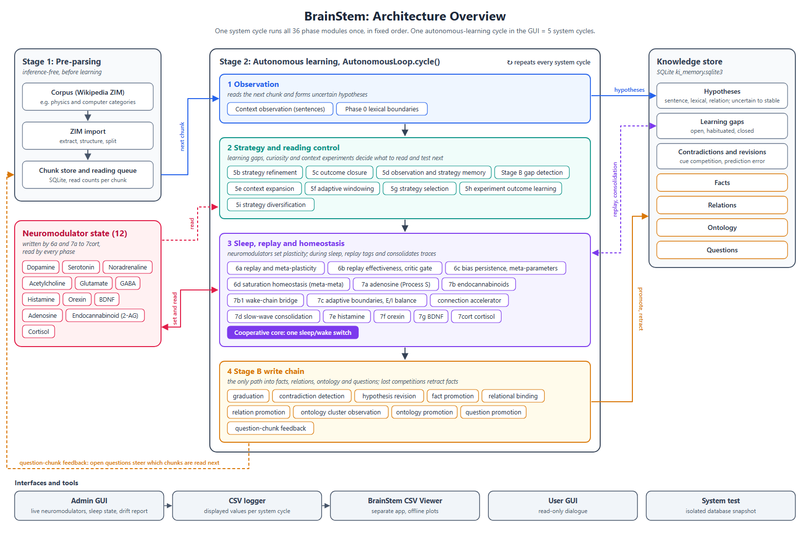

## BrainStem Update 12.11.26

[](#current-state)
[](#running-the-system)
[](#database-and-schema-discipline)
[](#roadmap)

BrainStem is a biologically inspired, Real Neuro-Symbolic (RNS-AI) cognitive architecture for lifelong learning. It starts as a tabula rasa: without any prior knowledge, word lists or grammar, it learns models of the structures and dynamics of text through context hypotheses, uncertainty, competition, prediction error, revision, neuromodulation, sleep replay and consolidation. Early output is expected to be noisy; the system is built to correct itself and to improve over time.

Five observation layers work together: sentence-level context hypotheses, a character-level layer that discovers word boundaries from unsegmented text, a relational layer that binds co-occurring elements, a categorical layer that clusters the relation graph, and a curiosity layer that turns persistent information gaps into questions that steer further reading.

One CPU Core / No GPU

> [!IMPORTANT]
> BrainStem is a research and calibration system, not a production-ready assistant. The productive write paths (facts, relations, ontology categories, questions and their promotion and retraction) are open as an explicitly framed, ongoing experiment. Every promoted artifact remains traceable to, and retractable from, its source hypothesis or gap.

---
[](https://www.youtube.com/watch?v=4nN7zELSAMo)
YouTube - AI conversation about BrainStem Project
---
[NotebookLM codebase exploration](https://notebook.google.com/notebook/34b994eb-9f62-4fd7-a04d-facbd6041654) 24.09.2026
---
### Navigation
- [Current State](#current-state)
- [What is BrainStem really](#what-is-brainstem-really)
- [Roadmap](#roadmap)
- [Architecture](#architecture)
- [Sleep, Replay and Consolidation](#sleep-replay-and-consolidation)
- [Self-Correction: Cue Competition and Prediction Error](#self-correction-cue-competition-and-prediction-error)
- [Emergence Layers](#emergence-layers)
- [Digital Neuromodulator Cockpit](#digital-neuromodulator-cockpit)
- [Neuromodulator-Coupled Thresholds](#neuromodulator-coupled-thresholds)
- [Performance](#performance)
- [Running the System](#running-the-system)
- [ZIM Import](#zim-import)
- [Academic References](#academic-references)
- [Development Notes](#development-notes)

---
### Current State

#### Status as of 12 November 2026

- **Runtime chain:** 36 phase modules, loaded by `ki_system/phase_registry.py`. The chain top is the Stage-B question-chunk feedback.
- **All layers learn:** sentence hypotheses, lexical boundaries and relation hypotheses all take part in sleep consolidation and graduate into stable roles. In a 150-cycle run on 300 real Wikipedia chunks the system graduated 35 sentence, 15 lexical-boundary and 35 relation hypotheses and promoted 33 facts, 12 relations and 11 ontology rows.
- **Self-correction works:** consolidated hypotheses compete with alternative completions of the same learned cue. A decisively stronger competitor is treated as a prediction error: the stored hypothesis is reverted to uncertain, its fact is retracted and the hypothesis has to be consolidated again. This happens without any external trigger (example from a test run: cue "April 20", stored evidence 1 vs. competitor evidence 3).
- **Speed:** about 1.3 to 1.6 s per learning cycle on the full production database (5.6 GB, 167,661 chunks, 937,552 hypotheses), about 0.9 s on a small corpus.
- **Stability:** system test fully green; repeated multi-hundred-cycle runs without exceptions or hidden error states in the nested cycle results.
- **Reading strategies use live state:** phases 5b to 5i take their learning controls (learning rate, error weight, revision, exploration, inhibition, consolidation) and the six core neuromodulators from the live state of Phases 6a and 7c, cluster the real curiosity questions, and read gap resolution from the actual gap status. Phase 5b's exploration and inhibition recommendations act back on the persistent bias state with a damped step (top-down strategy control), counterbalanced by saturation homeostasis (6d) and the endocannabinoid pull (7b).
- **One sleep trigger, developmental sleep share:** a single sleep/wake switch decides when the system sleeps. Adenosine (Process S) rises with the encoding load of each cycle and falls during sleep; sleep starts at an upper and ends at a lower threshold. Like a newborn, the immature system builds up sleep pressure faster and sleeps about two thirds of the time; as consolidated knowledge grows, wake episodes lengthen toward the adult rhythm of about 55 wake and 22 sleep cycles (about 28% sleep). In a 400-cycle run from a fresh database the system slept 62% of the time and graduated 231 hypotheses (103 with a fixed adult rhythm); only 3 of 275 tagged survivors expired before consolidation.
- **Cortisol Stage 2** is active (guarded soft regulator; per-value cap 0.01, per-cycle budget 0.03, 3-cycle cooldown).

#### Production database

The production database `ki_memory.sqlite3` holds the German Wikipedia categories _Physics_ and _Computer_ (2 documents, 167,661 chunks). Since the last corpus-preserving learning reset, 1,947 learning cycles have run and 37.1% of the chunks have been read. The new replay and self-correction mechanisms described below have not yet run on this database; it was last used before they existed.

#### Earlier validation (September 2026)

A full read-through of the corpus and more than 11,500 learning cycles ran without data loss or corruption. A 1,500-cycle sensory-deprivation drift run (input disabled, inner dynamics only) ended with the overall verdict **"konvergiert"**: all 20 evaluated signals were stable or converging, none divergent.

---
### Next Major Steps
- Run the new replay, cue competition and reconsolidation mechanisms over a long period on the full production corpus and observe how quality develops.
- Observe the exploration bias: with many unresolved gaps it currently sits at the upper bound of Phase 5b's strategy control.
- Observe whether the neuromodulators leave their current high-noradrenaline state once more gaps are closed by the new correction path.
- Catastrophic-forgetting test (Tadros/Bazhenov motivated): import a second, topically distinct corpus and measure whether already consolidated knowledge is protected, degraded or reinforced.

---
### Roadmap

<table>
<tr><th>Stage</th><th>Status</th><th>Gating condition to proceed</th></tr>
<tr><td>**Stage A: Core stability**</td><td>Complete: full corpus read-through, 11,500+ cycles, 1,500-cycle drift run "konvergiert"</td><td>Complete</td></tr>
<tr><td>**Stage B: Guarded graduation**</td><td>Active for all three eligible roles (sentence, lexical boundary, relation), neuromodulator-coupled role selection</td><td>Ongoing observation</td></tr>
<tr><td>**Sleep/wake switch**</td><td>Active: one switch with hysteresis, adenosine driven by encoding load, thresholds shifted by arousal and inhibition</td><td>Long-run observation on the production corpus</td></tr>
<tr><td>**Prioritized sleep replay**</td><td>Active: three replay tracks with neuromodulated capacity, tagged and random sampling, per-population down-selection</td><td>Long-run observation on the production corpus</td></tr>
<tr><td>**Self-correction (cue competition)**</td><td>Active: learned partial cues, evidence-decided competition, revision, fact retraction, reconsolidation requirement</td><td>Long-run observation on the production corpus</td></tr>
<tr><td>**Lexical emergence (Phase 0)**</td><td>Active, takes part in consolidation and graduation with its own replay quota</td><td>Calibration of context length and entropy threshold</td></tr>
<tr><td>**Relations emergence (Module A)**</td><td>Active and productive</td><td>Observation at production scale</td></tr>
<tr><td>**Ontology emergence (Module B)**</td><td>Active and productive</td><td>Observation at production scale</td></tr>
<tr><td>**Questions emergence (Module C)**</td><td>Active and productive, including curiosity-directed reading</td><td>Observation at production scale</td></tr>
<tr><td>**Full corpus scaling** (complete German Wikipedia)</td><td>Deliberately deferred</td><td>Order-of-magnitude estimate only</td></tr>
<tr><td>**Vector database evaluation**</td><td>Deliberately deferred</td><td>Only once stable hypothesis identities exist, a concrete semantic-retrieval use case is identified, and a shadow comparison against the SQLite baseline is performed</td></tr>
<tr><td>**Symbolic reasoning plugin** (deterministic, non-LLM rule engine)</td><td>Concept documented, not scheduled</td><td>Gated behind Stage-B graduation; a validated rule becoming productive must be gated at least as strictly as fact promotion</td></tr>
<tr><td>**Multi-core / multi-process learning**</td><td>Out of scope for now</td><td>Not planned</td></tr>
</table>

---
### Core Philosophy

Traditional semantic systems focus on the **what**: storing and retrieving content. BrainStem focuses on the **how**: learning how context, uncertainty, evidence, competition, revision and consolidation interact over time. A corpus is treated as training substrate rather than as a static knowledge base.

Core principles:
- **Tabula rasa, learning before rules:** no lexical blacklists, no hand-authored word roles, no grammar. Even the cue used for self-correction ends at a word boundary the system learned itself.
- **Errors remain evidence:** contradicted hypotheses are reverted, not deleted; a fact, relation or category is retracted, not silently overwritten.
- **Consolidation before promotion:** every fact, relation, category and question traces back to a source hypothesis or gap that survived consolidation and graduation or persistence gates.
- **Neuromodulation governs learning:** learning rate, error weighting, revision, confidence, exploration, inhibition, attention, replay capacity, cue length and consolidation are state-dependent.
- **Measure before changing:** diagnostics, audits, drift tests and shadow experiments precede active-control changes; where two neuroscience findings disagree on a coupling's direction, the system learns the direction from its own outcomes.

---
### What is BrainStem really

**BrainStem** is an autonomous software architecture for continuous, self-improving data processing and knowledge acquisition. An Autonomous Loop runs a chain of 36 learning phases that read, analyze, consolidate and revise information without manual intervention.

The biological terminology ("neuromodulators", "sleep", "homeostasis", "reconsolidation") is not decorative. The terms are functional designators for mathematical state variables and algorithmic control mechanisms. The values are floats, not molecules. The behavior is biologically inspired, the implementation is strictly mathematical.

**Main mechanics:**

**Dynamic steering variables:** digital messenger substances are meta-parameters that adjust learning rate, error weighting, exploration, replay capacity, cue length and many thresholds in real time.

**Active versus offline processing:** the system alternates between active reading and an offline phase ("sleep") in which hypotheses are replayed, consolidated or weakened.

**Competition and prediction error:** consolidated memories compete with alternative completions of the same learned cue; decisively contradicting evidence destabilizes them.

**Relational, categorical and curiosity-driven emergence:** stable elements are bound into relations, the relation graph is clustered into categories anchored by their most central member, and persistent gaps become questions that redirect reading.

**Knowledge distillation with retraction:** reliable hypotheses are promoted into facts, relations and ontology rows, and can be retracted when the underlying hypothesis is revised.

**Equilibrium control and adaptive boundaries:** homeostatic routines keep meta-parameters in a functional range; boundaries expand or contract with the system's state.

Every promoted fact, relation, category and question carries a complete provenance chain down to the source chunks. There is no black box: if the system states something, it can show why, and it can take it back if the evidence changes.

---
### Architecture

<a href="assets/Project-Structure.png" target="_blank">
  
</a>

BrainStem does not run as a continuously coupled system of differential equations. It traverses a cyclic state graph: each phase activates a few dominant neuromodulators while the rest stay passive. This sequential design prevents interaction cascades and keeps debugging deterministic.

#### Two-stage data pipeline

<table>
<tr><th>Stage</th><th>Name</th><th>Description</th></tr>
<tr><td>1</td><td>Inference-free pre-parsing</td><td>A raw corpus such as a Wikipedia ZIM file is extracted, structured and split into the chunk store before learning begins.</td></tr>
<tr><td>2</td><td>Autonomous learning</td><td>The AutonomousLoop processes chunks while the neuromodulatory, replay, consolidation and write-path chain reacts to the evolving internal state.</td></tr>
</table>

#### Runtime chain (36 phases, in execution order)

<table>
<tr><th>Group</th><th>Phases</th></tr>
<tr><td>Observation</td><td>Context observation (sentences), Phase 0 lexical boundaries</td></tr>
<tr><td>Strategy and reading control</td><td>Phases 5b to 5i, with Stage-B gap detection between 5d and 5e</td></tr>
<tr><td>Sleep and homeostasis</td><td>6a replay and meta-plasticity, 6b replay effectiveness and critic gate, 6c bias persistence and self-regulating meta-parameters, 6d saturation homeostasis, 7a adenosine, 7b endocannabinoids, 7b1 wake-chain bridge, 7c adaptive boundaries and E/I balance, connection accelerator, 7d slow-wave consolidation, 7e histamine, 7f orexin, 7g BDNF, 7cort cortisol, cooperative core</td></tr>
<tr><td>Stage B write chain</td><td>Graduation, contradiction detection, hypothesis revision, fact promotion, relational binding, relation promotion, ontology cluster observation, ontology promotion, question promotion, question-chunk feedback</td></tr>
</table>

The Stage B chain is ordered so that a competition decided in a cycle already causes its fact to be retracted within the same cycle, and a relation, cluster or question promoted in a cycle is already visible to the next module.

---
### Sleep, Replay and Consolidation

#### One sleep/wake switch

The decision between wake and sleep is made in exactly one place, the sleep/wake switch in the cooperative core. Every other module (Phase 7a adenosine, Phase 7d slow-wave consolidation, Phase 7e histamine) and the GUI read its state from `cooperative_sleep_wake_state`.

- **Sleep pressure (Process S, Phase 7a).** Adenosine rises during wake as a saturating exponential, `S = 1 - (1 - S) * exp(-k_wake)`, and decays during sleep exponentially, `S = S * exp(-k_sleep)`. The ratio of the two rates follows the two-process fits (rise time constant 18.2 h, decay time constant 4.2 h), scaled so that a wake episode at typical load lasts about 60 cycles.
- **What drives the rise.** The wake rate scales with encoding load: the new hypotheses and experiment outcomes of the cycle relative to the system's own running novelty level, `load = n / (n + reference)`. A burst of new material brings sleep forward, a quiet phase delays it. Glutamatergic activity scales the rise further, and GABAergic inhibition deepens the decay during sleep.
- **Switch with hysteresis.** Sleep starts when adenosine reaches the upper threshold (0.67) and ends when it has dissipated to the lower threshold (0.17). The gap between the two thresholds keeps transitions rare and complete, like the mutually inhibiting flip-flop between the sleep-active preoptic area and the arousal system. The arousal side (histamine, orexin, noradrenaline, acetylcholine, cortisol) and the GABAergic sleep side shift both thresholds together by at most 0.1, the role the circadian process plays in the two-process model. During sleep the switch suppresses histamine, which in turn stabilizes sleep.
- **Developmental sleep share.** The wake rate is multiplied by `1 + 4 * (1 - maturity)`, with `maturity = knowledge / (knowledge + 1000)` and knowledge being the net number of hypotheses in a stable role (a revision counts back down). A fresh system therefore builds up sleep pressure five times faster and sleeps about two thirds of the time, as newborns do; with growing consolidated knowledge the share falls toward the adult value. Only the rise changes with maturation, the decay stays the same, matching the finding that sleep pressure builds up faster in younger children while its dissipation is stable across development.
- **Not too early, not too late.** Depending on maturity, load and glutamate, a wake episode lasts between roughly 7 cycles (newborn, high load) and 150 cycles (mature, no new material), and a sleep episode about 20 to 23 cycles. Wake always ends inside the dopamine-modulated synaptic tag window of Phase 7d (225 to 375 cycles), so tagged traces are consolidated before they decay, while enough new material accumulates between two sleep episodes to make replay worthwhile. At sleep onset, saturated meta-plasticity biases are pulled back toward their mid values.

#### Prioritized replay (Phase 7d)

The slow-wave replay pool is composed of three tracks, each with its own capacity:

- **Anchors** (consolidated knowledge), interleaved to protect old knowledge from interference; share coupled to serotonin.
- **Tagged survivors** (hypotheses with one or two consolidation survivals), comparable to synaptic tags that need capture before they decay; share and tag lifetime coupled to dopamine.
- **Novel items**, sampled per role (sentence, relation, lexical boundary) partly from recently re-observed material (tagged by wake experience) and partly by uniform random coverage of the whole population; share coupled to noradrenaline.

Track shares are normalized (divisive normalization) and equal the calibrated base values at neutral messenger levels. Novel items enter replay with an encoding strength derived from their own repetition history, so repeatedly observed structure consolidates more reliably than one-off noise. The down-selection threshold is applied within each memory population, so consolidated anchors do not raise the bar for new memories.

#### Critic gate and replay effectiveness

Phase 6b evaluates replay effectiveness and plasticity adjustments. The critic gate checks whether proposed changes stay consistent enough to be retained; the same critic gate is reused by Stage-B graduation.

#### Slow-wave substructure

Phase 7d models sub-1-Hz up/down states with stochastic reactivation, adaptive thresholds, activity-dependent participation and survivor statistics. Consolidation activity is gated by acetylcholine (low cholinergic tone permits consolidation).

#### Graduation and reconsolidation

A hypothesis graduates into a stable role after at least three confirmed consolidation survivals, a critic-gate cross-check and warm-up, with one graduation per cycle shared between the roles by neuromodulator-coupled divisive normalization. A hypothesis that was reverted after a prediction error must earn its consolidation again: only survivals recorded after its revision count.

---
### Self-Correction: Cue Competition and Prediction Error

Implemented in `v8_cue_competition.py` together with gap detection, contradiction detection, hypothesis revision and fact promotion.

1. **Learned partial cue:** for every consolidated sentence hypothesis, the cue is the shortest prefix that ends at a word boundary learned by the Phase-0 lexical layer and covers a minimum fraction of the pattern. The fraction is coupled to acetylcholine (high ACh favors pattern separation and requires a longer cue, low ACh favors pattern completion).
2. **Competition:** every other observed completion of the same cue that differs from the stored pattern is a competitor; their coexistence becomes a contested gap.
3. **Decision from evidence only:** a competitor with decisively more evidence is a prediction error ("resolvable"); a decisively stronger stored pattern is "confirmed"; anything in between stays "open". The decisive ratio is scaled by noradrenaline (unexpected uncertainty).
4. **Revision and retraction:** the losing stored hypothesis is reverted to uncertain, its fact is retracted, the contested gap is closed.
5. **Reconsolidation:** the reverted hypothesis needs new consolidation survivals before it can graduate again, which prevents oscillation.

Early in learning, the learned word boundaries and therefore the cues are noisy. This is intended: the decisive-evidence requirement keeps noise from reverting anything, and both boundaries and competitions sharpen as the lexical layer learns.

---
### Emergence Layers

#### Lexical emergence (Phase 0)

Phase 0 reads the raw, unsegmented character stream, maintains a frequency table of which character follows a preceding context of length _k_, and computes the local branching entropy:

H(context) = - Σ P(next_char | context) · log2 P(next_char | context)

A position with high entropy is a boundary candidate (`uncertain_lexical_boundary`). Candidates use the same consolidation and graduation path as every other hypothesis and become eligible as relation elements once their own evidence clears a small threshold, reflecting evidence that word segmentation and relational learning proceed in parallel in human learners.

#### Relations (Module A)

`v8_phase0b_relational_binding_observation_release` binds pairs of stable elements that co-occur in a sentence via a symmetric PMI existence gate, PMI(A;B) = log2(P(A,B)/(P(A)·P(B))), followed by a positional direction signal calibrated per corpus language. `v8_stageb_relation_promotion_release` promotes graduated relation hypotheses into `relations`, retractable on revision.

#### Ontology (Module B)

`v8_stageb_ontology_cluster_observation_release` clusters the relation graph with Label Propagation and anchors cluster identity to its prototype, the most central member (Rosch). `v8_stageb_ontology_promotion_release` promotes reconfirmed stable clusters into `ontology` as association membership with the placeholder relation `member_of_cluster`; no category name is invented.

#### Questions (Module C)

`v8_stageb_question_promotion_release` promotes a persistent, repeatedly reconfirmed gap into a question (Information-Gap Theory of curiosity). The question text is a fixed marker plus already observed surface text; no sentence is generated. `v8_stageb_question_chunk_feedback_release` boosts the source chunk of every open question and searches the corpus via FTS5 for not yet read chunks that might resolve it.

#### Habituation

A persistent but unproductive gap (no evidence growth for a serotonin-modulated number of reconfirmations) is retired into a reversible `habituated` state, following the inverted-U relationship between resolvability and curiosity.

---
### Digital Neuromodulator Cockpit

BrainStem uses **12 digital neuromodulators**, normalized to [0.0, 1.0] and derived from the internal system state under bounded, homeostatic dynamics.

<table>
<tr><th>Neuromodulator</th><th>Engineering role</th></tr>
<tr><td>Dopamine</td><td>outcome and gap-closure signal; question priority, ontology overlap tolerance, replay capacity for tagged memories, tag lifetime, share of tagged novel samples</td></tr>
<tr><td>Serotonin</td><td>consolidation and stability; habituation resistance, cluster-stability requirement, replay capacity for consolidated anchors</td></tr>
<tr><td>Glutamate</td><td>excitatory drive, exploration and learning activity</td></tr>
<tr><td>GABA</td><td>global inhibition and E/I balance; sharpness of role competition at graduation</td></tr>
<tr><td>Noradrenaline</td><td>error, alarm and unexpected uncertainty; existence gates, decisive ratio of competitions, replay capacity for novel items, ontology minimum cluster size (direction learned from outcomes)</td></tr>
<tr><td>Acetylcholine</td><td>novelty, attention and structural revision; relation direction, revision budget, graduation novelty pressure, ontology promotion budget, consolidation gating, cue length (pattern separation vs. completion)</td></tr>
<tr><td>Adenosine</td><td>sleep-pressure homeostat</td></tr>
<tr><td>Endocannabinoids</td><td>retrograde gain control (2-AG phasic, anandamide tonic)</td></tr>
<tr><td>Cortisol</td><td>top-level stability watcher and guarded soft regulator (Stage 2 active)</td></tr>
<tr><td>Histamine</td><td>wake and arousal</td></tr>
<tr><td>Orexin</td><td>reading endurance and curiosity drive</td></tr>
<tr><td>BDNF</td><td>activity-dependent growth and consolidation substrate</td></tr>
</table>

GABA regulates system-level inhibition and competitive sharpness; it never suppresses individual words. All 12 displays are connected in the GUI.

---
### Neuromodulator-Coupled Thresholds

Each coupling uses the same symmetric gain and equals the calibrated value at the messenger's neutral value of 0.5.

| Coupling | Messenger(s) | Grounding |
|---|---|---|
| Gap detection existence gate | Noradrenaline | Aston-Jones & Cohen (2005) |
| Gap habituation threshold | Serotonin | Grossman, Bari & Cohen (2022); Hochner et al. (1986) |
| Relational binding existence gate | Noradrenaline | Aston-Jones & Cohen (2005) |
| Relational binding direction threshold | Acetylcholine | Structural-revision role |
| Hypothesis revision budget | Acetylcholine | Structural-revision role |
| Decisive evidence ratio of cue competitions | Noradrenaline | Yu & Dayan (2005); Aston-Jones & Cohen (2005) |
| Cue length (fraction of the pattern) | Acetylcholine | Hasselmo (2006); Hasselmo & McGaughy (2004) |
| Graduation role-selection pressure | Acetylcholine | Douchamps et al. (2013); Gómez-Ocádiz et al. (2022) |
| Graduation divisive-normalization temperature | GABA | Katzner, Busse & Carandini (2011) |
| Replay capacity: anchors / tagged / novel | Serotonin / Dopamine / Noradrenaline | McClelland et al. (1995); Frey & Morris (1997); Lisman, Grace & Duzel (2011); Yu & Dayan (2005) |
| Tag lifetime and share of tagged novel samples | Dopamine | Frey & Morris (1997); Lisman, Grace & Duzel (2011) |
| Ontology stability streak | Serotonin | Grossman, Bari & Cohen (2022) |
| Ontology minimum cluster size | Noradrenaline (self-regulating direction) | Aston-Jones & Cohen (2005) vs. Shine et al. (2018) |
| Ontology overlap threshold | Dopamine | Kahnt & Tobler (2016); Novicky et al. (2023) |
| Ontology promotion budget | Acetylcholine | Structural-revision role |
| Question existence gate | Noradrenaline | Aston-Jones & Cohen (2005) |
| Question priority | Dopamine, Acetylcholine | Gap-closure and curiosity roles |
| Question-chunk feedback boost | inherits question priority | Consistency with the upstream signal |
| Phase 7d consolidation gate | Acetylcholine | Gais & Born (2004); Hasselmo & McGaughy (2004) |
| Learning controls of the reading-strategy phases 5b to 5i | Meta-plasticity state of Phase 6a; error weight from noradrenaline | Yu & Dayan (2005); Nassar et al. (2012) |

The noradrenaline coupling of the ontology minimum cluster size is deliberately not hardcoded in either direction. Two plausible findings disagree on its sign, so the system learns the sign from its own promotion and retraction outcomes once both outcome groups hold enough evidence.

---
### Performance

Measured on a copy of the production database (5.6 GB): about 1.3 to 1.6 s per learning cycle, on a small corpus about 0.9 s.

- **Schema checks** run once per database connection instead of once per observed sentence.
- **Incrementally maintained aggregates** (`v8_outcome_aggregates.py`): phases 5h and 5i read group-wise counts and averages over the experiment-outcome history (about 0.9 million rows) from a small table that SQLite triggers keep current on insert, update and delete, instead of rescanning the history every cycle. Results are identical to the full scans.
- **Targeted indexes** for the per-cycle hot paths, including expression indexes whose key direction lets SQLite read them backwards for "ORDER BY expression, rowid DESC" scans.
- **Exactly one unique index** per table column, shared by all phase modules.
- **Cached corpus searches** for question-chunk feedback, valid until new chunks are imported.

---
### Safety Locks and Write Paths

Open as an explicitly framed experiment:
- fact, relation, ontology and question writes,
- promotion paths, each gated by graduation or persistence, each reversible via revision, cluster dissolution, gap closure or habituation,
- Phase-5f/5g/5i experimental writes,
- attention and internal-gap writes, including question-chunk feedback.

The provenance guarantee is unchanged: every artifact stays traceable to, and retractable from, its source. The architecture uses no word blacklists or hard-coded linguistic filters.

---
### Database and Schema Discipline

BrainStem uses `ki_memory.sqlite3` in the project root; it is created automatically when absent. `ki_system/db_bootstrap.py` is the central, idempotent schema authority: it creates tables, columns and indexes, and every written column must be declared there or in the owning module's own schema. Schema changes ship together with the bootstrap; structural changes require a full backup first.

#### Corpus-preserving learning reset

The learning state can be reset without re-importing the corpus (GUI button or `python -m ki_system.reset_learning --apply`). Documents, chunks, FTS data, import state and settings are preserved. The reset performs a dry run by default and creates a full project and database backup before any change.

---
### Sensory Deprivation and Drift Report

The GUI includes a sensory-deprivation mode that skips new reading while replay, consolidation and neuromodulatory dynamics continue, with start/stop controls, cycle limits, per-cycle CSV diagnostics, live graphs and signal-level drift verdicts.

---
### Running the System

From the project root: `python main.py --gui` (admin GUI) or `python main.py --user-gui` (read-only dialogue GUI).

System check on an isolated snapshot of the database: `python -m ki_system.systemtest`

#### Basic workflow

<table>
<tr><th>Step</th><th>GUI action</th><th>Purpose</th></tr>
<tr><td>1</td><td>Export / Configuration</td><td>Configure the maximum number of articles before import.</td></tr>
<tr><td>2</td><td>Import & Jobs, ZIM Einlesen</td><td>Extract and pre-parse the corpus.</td></tr>
<tr><td>3</td><td>Import & Jobs, Autonom dauerhaft starten</td><td>Start autonomous learning.</td></tr>
<tr><td>4</td><td>Import & Jobs, Autonom stoppen</td><td>Stop autonomous learning cooperatively.</td></tr>
<tr><td>5</td><td>Close the GUI normally</td><td>Wait for active workers instead of terminating them abruptly.</td></tr>
</table>

#### GUI areas
- Import and Jobs (including the toggleable CSV value logger)
- Export and Configuration
- Drift Report
- Live 12-neuromodulator display, corpus-coverage and cycle-progress indicators, bounded logs and graphs, cooperative worker shutdown

The GUI is an experimental testing interface.

#### CSV logger and BrainStem CSV Viewer

The "Logger aktiv" switch in Import and Jobs writes every value the GUI displays to `gui_log_YYYY-MM-DD_HHMMSS.csv` (neuromodulators, sleep state and thresholds, developmental maturity, learning progress), by default only when a value changes. These logs can be analyzed offline with the companion application **[BrainStem CSV Viewer](https://github.com/unikum-sol/BrainStem-CSV-Viewer)**: a standalone desktop tool (PySide6, pyqtgraph) that plots any number of curves over time, with one Y axis per curve, a normalized overlay or a shared axis, and a value readout under the cursor. It reads only the CSV files and needs neither the `ki_system` package nor the database.

---
### ZIM Import

A Windows `zimdump.exe` build and its DLL files must be placed in the project root next to `main.py`. Users provide their own ZIM corpus. The current development corpus is the German Wikipedia categories _Physics_ and _Computer_.

---
### Academic References

**Word segmentation and statistical language acquisition**
- **Saffran, Jenny R.; Aslin, Richard N.; Newport, Elissa L.** (1996) _Statistical Learning by 8-Month-Old Infants_. Science.
- **Aslin, Richard N.; Saffran, Jenny R.; Newport, Elissa L.** (1998) _Computation of Conditional Probability Statistics by 8-Month-Old Infants_. Psychological Science.
- **Fló, Ana; Benjamin, Lucas; Palu, Marisa; Dehaene-Lambertz, Ghislaine** (2022) _Sleeping neonates track transitional probabilities in speech but only retain the first syllable of words_. Scientific Reports.
- **Zhikov, Valentin; Takamura, Hiroya; Okumura, Manabu** _An Efficient Algorithm for Unsupervised Word Segmentation with Branching Entropy and MDL_.
- **Dal Ben, Rafael; Toselli Prequero, Lilian; de Hollanda Souza, Débora; Hay, Jessica F.** (2023) _Simultaneous word segmentation and word-referent mapping_. Open Mind.
- **Räsänen, Okko; Rasilo, Heikki** _Joint word segmentation and referential learning_ (computational model).
- **Yurovsky, Daniel; Yu, Chen; Smith, Linda B.** (2012) _Statistical speech segmentation and word learning in parallel_. Frontiers in Psychology.
- **Zhang, Yayun; Yurovsky, Daniel; Yu, Chen** (2015) _Statistical word learning as a continuous, cumulative process_.

**Memory replay, tagging and consolidation**
- **Mattar, Marcelo G.; Daw, Nathaniel D.** (2018) _Prioritized memory access explains planning and hippocampal replay_. Nature Neuroscience.
- **Schapiro, Anna C.; McDevitt, Elizabeth A.; Rogers, Timothy T.; Mednick, Sara C.; Norman, Kenneth A.** (2018) _Human hippocampal replay during rest prioritizes weakly learned information and predicts memory performance_. Nature Communications.
- **Wilson, Matthew A.; McNaughton, Bruce L.** (1994) _Reactivation of hippocampal ensemble memories during sleep_. Science.
- **Frey, Uwe; Morris, Richard G. M.** (1997) _Synaptic tagging and long-term potentiation_. Nature.
- **Lisman, John; Grace, Anthony A.; Duzel, Emrah** (2011) _A neoHebbian framework for episodic memory; role of dopamine-dependent late LTP_. Trends in Neurosciences.
- **McClelland, James L.; McNaughton, Bruce L.; O'Reilly, Randall C.** (1995) _Why there are complementary learning systems in the hippocampus and neocortex_. Psychological Review.
- **Tononi, Giulio; Cirelli, Chiara** (2014) _Sleep and the price of plasticity: from synaptic and cellular homeostasis to memory consolidation and integration_. Neuron.
- **Gais, Steffen; Born, Jan** (2004) _Low acetylcholine during slow-wave sleep is critical for declarative memory consolidation_. PNAS.

**Sleep regulation**
- **Borbély, Alexander A.** (1982) _A two process model of sleep regulation_. Human Neurobiology.
- **Daan, Serge; Beersma, Domien G. M.; Borbély, Alexander A.** (1984) _Timing of human sleep: recovery process gated by a circadian pacemaker_. American Journal of Physiology.
- **Skeldon, Anne C.; Dijk, Derk-Jan; Derks, Gianne** (2014) _Mathematical models for sleep-wake dynamics: comparison of the two-process model and a mutual inhibition neuronal model_. PLoS ONE.
- **Porkka-Heiskanen, Tarja; Strecker, Robert E.; Thakkar, Mahesh; Bjørkum, Alvhild A.; Greene, Robert W.; McCarley, Robert W.** (1997) _Adenosine: a mediator of the sleep-inducing effects of prolonged wakefulness_. Science.
- **Brambilla, Dario; Chapman, David; Greene, Robert** (2005) _Adenosine mediation of presynaptic feedback inhibition of glutamate release_. Neuron.
- **Tononi, Giulio; Cirelli, Chiara** (2006) _Sleep function and synaptic homeostasis_. Sleep Medicine Reviews.
- **Huber, Reto; Ghilardi, M. Felice; Massimini, Marcello; Tononi, Giulio** (2004) _Local sleep and learning_. Nature.
- **Saper, Clifford B.; Chou, Thomas C.; Scammell, Thomas E.** (2001) _The sleep switch: hypothalamic control of sleep and wakefulness_. Trends in Neurosciences.
- **Saper, Clifford B.; Scammell, Thomas E.; Lu, Jun** (2005) _Hypothalamic regulation of sleep and circadian rhythms_. Nature.
- **Sherin, Jonathan E.; Elmquist, Joel K.; Torrealba, Fernando; Saper, Clifford B.** (1998) _Innervation of histaminergic tuberomammillary neurons by GABAergic and galaninergic neurons in the ventrolateral preoptic nucleus of the rat_. Journal of Neuroscience.
- **Takahashi, Kazumi; Lin, Jian-Sheng; Sakai, Kazuya** (2006) _Neuronal activity of histaminergic tuberomammillary neurons during wake-sleep states in the mouse_. Journal of Neuroscience.
- **Roffwarg, Howard P.; Muzio, Joseph N.; Dement, William C.** (1966) _Ontogenetic development of the human sleep-dream cycle_. Science.
- **Jenni, Oskar G.; Achermann, Peter; Carskadon, Mary A.** (2005) _Homeostatic sleep regulation in adolescents_. Sleep.
- **Tarokh, Leila; Carskadon, Mary A.; Achermann, Peter** (2012) _Dissipation of sleep pressure is stable across adolescence_. Neuroscience.
- **Feinberg, Irwin; Campbell, Ian G.** (2010) _Sleep EEG changes during adolescence: an index of a fundamental brain reorganization_. Brain and Cognition.
- **Walsh, James K.; et al.** (2008) _Slow wave sleep enhancement with gaboxadol reduces daytime sleepiness during sleep restriction_. Sleep.

**Retrieval competition, prediction error and reconsolidation**
- **Anderson, Michael C.; Bjork, Robert A.; Bjork, Elizabeth L.** (1994) _Remembering can cause forgetting: Retrieval dynamics in long-term memory_. Journal of Experimental Psychology: Learning, Memory, and Cognition.
- **Sevenster, Dieuwke; Beckers, Tom; Kindt, Merel** (2013) _Prediction error governs pharmacologically induced amnesia for learned fear_. Science.
- **Nader, Karim; Schafe, Glenn E.; LeDoux, Joseph E.** (2000) _Fear memories require protein synthesis in the amygdala for reconsolidation after retrieval_. Nature.
- **Rolls, Edmund T.** (2016) _Pattern separation, completion, and categorisation in the hippocampus and neocortex_. Neurobiology of Learning and Memory.
- **Yassa, Michael A.; Stark, Craig E. L.** (2011) _Pattern separation in the hippocampus_. Trends in Neurosciences.

**Acetylcholine, noradrenaline and uncertainty**
- **Yu, Angela J.; Dayan, Peter** (2005) _Uncertainty, neuromodulation, and attention_. Neuron.
- **Cohen, Jonathan D.; McClure, Samuel M.; Yu, Angela J.** (2007) _Should I stay or should I go? How the human brain manages the trade-off between exploitation and exploration_. Philosophical Transactions of the Royal Society B.
- **Nassar, Matthew R.; Rumsey, Katherine M.; Wilson, Robert C.; Parikh, Kinjal; Heasly, Benjamin; Gold, Joshua I.** (2012) _Rational regulation of learning dynamics by pupil-linked arousal systems_. Nature Neuroscience.
- **Hasselmo, Michael E.** (2006) _The role of acetylcholine in learning and memory_. Current Opinion in Neurobiology.
- **Hasselmo, Michael E.; McGaughy, Jill** (2004) _High acetylcholine levels set circuit dynamics for attention and encoding and low acetylcholine levels set dynamics for consolidation_. Progress in Brain Research.
- **Aston-Jones, Gary; Cohen, Jonathan D.** (2005) _An Integrative Theory of Locus Coeruleus-Norepinephrine Function: Adaptive Gain and Optimal Performance_. Annual Review of Neuroscience.
- **Shine, James M.; Aburn, Matthew J.; Breakspear, Michael; Poldrack, Russell A.** (2018) _The modulation of neural gain facilitates a transition between functional segregation and integration in the brain_. eLife.
- **Zerbi, Valerio; et al.** (2019) _Rapid Reconfiguration of the Functional Connectome after Chemogenetic Locus Coeruleus Activation_. Neuron.
- **Douchamps, Vincent; Jeewajee, Ali; Blundell, Pam; Burgess, Neil; Lever, Colin** (2013) _Evidence for Encoding versus Retrieval Scheduling in the Hippocampus by Theta Phase and Acetylcholine_. Journal of Neuroscience.
- **Gómez-Ocádiz, Ruy; et al.** (2022) _A synaptic signal for novelty processing in the hippocampus_. Nature Communications.

**Dopamine, serotonin, GABA and normalization**
- **Kahnt, Thorsten; Tobler, Philippe N.** (2016) _Dopamine regulates stimulus generalization in the human hippocampus_. eLife.
- **Novicky, Filip; Parr, Thomas; Friston, Karl; Mirza, M. Berk; Sajid, Noor** (2023) _Bistable perception, precision and neuromodulation_. Cerebral Cortex.
- **Grossman, Cooper D.; Bari, Bilal A.; Cohen, Jeremiah Y.** (2022) _Serotonin neurons modulate learning rate through uncertainty_. Current Biology.
- **Katzner, Steffen; Busse, Laura; Carandini, Matteo** (2011) _GABA_A Inhibition Controls Response Gain in Visual Cortex_. Journal of Neuroscience.
- **Carandini, Matteo; Heeger, David J.** (2012) _Normalization as a canonical neural computation_. Nature Reviews Neuroscience.

**Curiosity, information gaps and habituation**
- **Loewenstein, George** (1994) _The Psychology of Curiosity: A Review and Reinterpretation_. Psychological Bulletin.
- **Golman, Russell; Loewenstein, George** (2016) _An Information-Gap Theory of Feelings About Uncertainty_. Working paper.
- **Kang, Min Jeong; et al.** (2009) _The Wick in the Candle of Learning_. Psychological Science.
- **Ten, Alexandr; Oudeyer, Pierre-Yves; Sakaki, Michiko; Murayama, Kou** (2025) _The Curious U_. Open Mind.
- **Modirshanechi, Alireza; Kondrakiewicz, Kacper; Gerstner, Wulfram; Haesler, Sebastian** (2023) _Curiosity-driven exploration: foundations in neuroscience and computational modeling_. Trends in Neurosciences.
- **Ueda, Kazutaka; Sekoguchi, Takahiro; Yanagisawa, Hideyoshi** (2021) _How predictability affects habituation to novelty_. PLoS One.
- **Smart, Matthew; Shvartsman, Stanislav Y.; Mönnigmann, Martin** (2026) _Dynamical principles of habituation across substrates and scales_. Annual Review of Control, Robotics, and Autonomous Systems.
- **Hochner, Binyamin; Klein, Marc; Schacher, Samuel; Kandel, Eric R.** (1986) _Additional component in the cellular mechanism of presynaptic facilitation contributes to behavioral dishabituation in Aplysia_. PNAS.
- **Cohen, Thomas E.; Kaplan, Samuel W.; Kandel, Eric R.; Hawkins, Robert D.** (1997) _A simplified preparation for relating cellular events to behavior_. Journal of Neuroscience.

**Categories and complementary learning systems**
- **Rosch, Eleanor** (1973) _Natural categories_. Cognitive Psychology.
- **Sun, Weinan; Advani, Madhu; Spruston, Nelson; Saxe, Andrew; Fitzgerald, James E.** (2023) _Organizing memories for generalization in complementary learning systems_. Nature Neuroscience.
- **Singh, Dhairyya; Schapiro, Anna C.** (2026) _A computational account of complementary learning systems_. Philosophical Transactions of the Royal Society B.

**Homeostasis, sleep algorithms and related principles**
- **Butz, Markus; van Ooyen, Arjen** (2013/2014) _Homeostatic structural plasticity: a key to neuronal network formation and repair_. PLoS Computational Biology.
- **Lee, Kea-Joo K.; Kirkwood, Alfredo** (2019) _Mechanisms of Homeostatic Synaptic Plasticity In Vivo_. Frontiers in Cellular Neuroscience.
- **Tadros, Timothy; Tran, Gia-Bao M.; Krishnan, Giri P.; Bazhenov, Maxim** (2022) _Biologically Inspired Sleep Algorithm for Reducing Catastrophic Forgetting in Neural Networks_.
- **Watkins, Yijing; Kim, Edward; Kenyon, Garrett T.** (2020) _Using Sinusoidally-Modulated Noise as a Surrogate for Slow-Wave Sleep_. Frontiers in Computational Neuroscience.
- **Hamilton, William L.** (2020) _Graph Representation Learning_. Morgan & Claypool Publishers.
- **Parker, Paul A.; Holan, Scott H.; Ravishanker, Nalini** (2020) _Nonlinear Time Series Classification Using Bispectrum-based Deep Convolutional Neural Networks_. arXiv:2003.02353.

**Database engineering**
- **Gupta, Ashish; Mumick, Inderpal Singh** (1995) _Maintenance of Materialized Views: Problems, Techniques, and Applications_. IEEE Data Engineering Bulletin.
- **Koch, Christoph; et al.** (2014) _DBToaster: higher-order delta processing for dynamic, frequently fresh views_. The VLDB Journal.
- **Chaudhuri, Surajit; Narasayya, Vivek R.** (1997) _An Efficient, Cost-Driven Index Selection Tool for Microsoft SQL Server_. VLDB.
- **Gaffney, Kevin P.; Prammer, Martin; Brasfield, Larry; Hipp, D. Richard; Kennedy, Dan; Patel, Jignesh M.** (2022) _SQLite: Past, Present, and Future_. PVLDB.

<details>
<summary><b>Click to expand BibTeX citations</b></summary>

```bibtex
@article{mattar2018prioritized,
  title={Prioritized memory access explains planning and hippocampal replay},
  author={Mattar, Marcelo G. and Daw, Nathaniel D.},
  journal={Nature Neuroscience}, volume={21}, pages={1609--1617}, year={2018}
}
@article{schapiro2018human,
  title={Human hippocampal replay during rest prioritizes weakly learned information and predicts memory performance},
  author={Schapiro, Anna C. and McDevitt, Elizabeth A. and Rogers, Timothy T. and Mednick, Sara C. and Norman, Kenneth A.},
  journal={Nature Communications}, volume={9}, pages={3920}, year={2018}
}
@article{frey1997synaptic,
  title={Synaptic tagging and long-term potentiation},
  author={Frey, Uwe and Morris, Richard G. M.},
  journal={Nature}, volume={385}, pages={533--536}, year={1997}
}
@article{lisman2011neohebbian,
  title={A neoHebbian framework for episodic memory; role of dopamine-dependent late LTP},
  author={Lisman, John and Grace, Anthony A. and Duzel, Emrah},
  journal={Trends in Neurosciences}, volume={34}, number={10}, pages={536--547}, year={2011}
}
@article{yu2005uncertainty,
  title={Uncertainty, neuromodulation, and attention},
  author={Yu, Angela J. and Dayan, Peter},
  journal={Neuron}, volume={46}, pages={681--692}, year={2005}
}
@article{nassar2012rational,
  title={Rational regulation of learning dynamics by pupil-linked arousal systems},
  author={Nassar, Matthew R. and Rumsey, Katherine M. and Wilson, Robert C. and Parikh, Kinjal and Heasly, Benjamin and Gold, Joshua I.},
  journal={Nature Neuroscience}, volume={15}, number={7}, pages={1040--1046}, year={2012}
}
@article{sevenster2013prediction,
  title={Prediction error governs pharmacologically induced amnesia for learned fear},
  author={Sevenster, Dieuwke and Beckers, Tom and Kindt, Merel},
  journal={Science}, volume={339}, pages={830--833}, year={2013}
}
@article{borbely1982two,
  title={A two process model of sleep regulation},
  author={Borb{\'e}ly, Alexander A.},
  journal={Human Neurobiology}, volume={1}, pages={195--204}, year={1982}
}
@article{daan1984timing,
  title={Timing of human sleep: recovery process gated by a circadian pacemaker},
  author={Daan, Serge and Beersma, Domien G. M. and Borb{\'e}ly, Alexander A.},
  journal={American Journal of Physiology}, volume={246}, pages={R161--R178}, year={1984}
}
@article{skeldon2014mathematical,
  title={Mathematical models for sleep-wake dynamics: comparison of the two-process model and a mutual inhibition neuronal model},
  author={Skeldon, Anne C. and Dijk, Derk-Jan and Derks, Gianne},
  journal={PLoS ONE}, volume={9}, number={8}, pages={e103877}, year={2014}
}
@article{porkkaheiskanen1997adenosine,
  title={Adenosine: a mediator of the sleep-inducing effects of prolonged wakefulness},
  author={Porkka-Heiskanen, Tarja and Strecker, Robert E. and Thakkar, Mahesh and Bj{\o}rkum, Alvhild A. and Greene, Robert W. and McCarley, Robert W.},
  journal={Science}, volume={276}, pages={1265--1268}, year={1997}
}
@article{brambilla2005adenosine,
  title={Adenosine mediation of presynaptic feedback inhibition of glutamate release},
  author={Brambilla, Dario and Chapman, David and Greene, Robert},
  journal={Neuron}, volume={46}, number={2}, pages={275--283}, year={2005}
}
@article{tononi2006sleep,
  title={Sleep function and synaptic homeostasis},
  author={Tononi, Giulio and Cirelli, Chiara},
  journal={Sleep Medicine Reviews}, volume={10}, number={1}, pages={49--62}, year={2006}
}
@article{huber2004local,
  title={Local sleep and learning},
  author={Huber, Reto and Ghilardi, M. Felice and Massimini, Marcello and Tononi, Giulio},
  journal={Nature}, volume={430}, pages={78--81}, year={2004}
}
@article{saper2001sleep,
  title={The sleep switch: hypothalamic control of sleep and wakefulness},
  author={Saper, Clifford B. and Chou, Thomas C. and Scammell, Thomas E.},
  journal={Trends in Neurosciences}, volume={24}, number={12}, pages={726--731}, year={2001}
}
@article{saper2005hypothalamic,
  title={Hypothalamic regulation of sleep and circadian rhythms},
  author={Saper, Clifford B. and Scammell, Thomas E. and Lu, Jun},
  journal={Nature}, volume={437}, pages={1257--1263}, year={2005}
}
@article{sherin1998innervation,
  title={Innervation of histaminergic tuberomammillary neurons by GABAergic and galaninergic neurons in the ventrolateral preoptic nucleus of the rat},
  author={Sherin, Jonathan E. and Elmquist, Joel K. and Torrealba, Fernando and Saper, Clifford B.},
  journal={Journal of Neuroscience}, volume={18}, number={12}, pages={4705--4721}, year={1998}
}
@article{takahashi2006neuronal,
  title={Neuronal activity of histaminergic tuberomammillary neurons during wake-sleep states in the mouse},
  author={Takahashi, Kazumi and Lin, Jian-Sheng and Sakai, Kazuya},
  journal={Journal of Neuroscience}, volume={26}, number={40}, pages={10292--10298}, year={2006}
}
@article{roffwarg1966ontogenetic,
  title={Ontogenetic development of the human sleep-dream cycle},
  author={Roffwarg, Howard P. and Muzio, Joseph N. and Dement, William C.},
  journal={Science}, volume={152}, number={3722}, pages={604--619}, year={1966}
}
@article{jenni2005homeostatic,
  title={Homeostatic sleep regulation in adolescents},
  author={Jenni, Oskar G. and Achermann, Peter and Carskadon, Mary A.},
  journal={Sleep}, volume={28}, number={11}, pages={1446--1454}, year={2005}
}
@article{tarokh2012dissipation,
  title={Dissipation of sleep pressure is stable across adolescence},
  author={Tarokh, Leila and Carskadon, Mary A. and Achermann, Peter},
  journal={Neuroscience}, volume={216}, pages={167--177}, year={2012}
}
@article{feinberg2010sleep,
  title={Sleep EEG changes during adolescence: an index of a fundamental brain reorganization},
  author={Feinberg, Irwin and Campbell, Ian G.},
  journal={Brain and Cognition}, volume={72}, number={1}, pages={56--65}, year={2010}
}
@article{walsh2008slow,
  title={Slow wave sleep enhancement with gaboxadol reduces daytime sleepiness during sleep restriction},
  author={Walsh, James K. and others},
  journal={Sleep}, volume={31}, number={5}, pages={659--672}, year={2008}
}
@article{anderson1994remembering,
  title={Remembering can cause forgetting: Retrieval dynamics in long-term memory},
  author={Anderson, Michael C. and Bjork, Robert A. and Bjork, Elizabeth L.},
  journal={Journal of Experimental Psychology: Learning, Memory, and Cognition}, year={1994}
}
@article{tononi2014sleep,
  title={Sleep and the price of plasticity: from synaptic and cellular homeostasis to memory consolidation and integration},
  author={Tononi, Giulio and Cirelli, Chiara},
  journal={Neuron}, volume={81}, number={1}, pages={12--34}, year={2014}
}
@article{aston-jones2005integrative,
  title={An Integrative Theory of Locus Coeruleus-Norepinephrine Function: Adaptive Gain and Optimal Performance},
  author={Aston-Jones, Gary and Cohen, Jonathan D.},
  journal={Annual Review of Neuroscience}, year={2005}
}
@article{kahnt2016dopamine,
  title={Dopamine regulates stimulus generalization in the human hippocampus},
  author={Kahnt, Thorsten and Tobler, Philippe N.},
  journal={eLife}, year={2016}
}
@article{grossman2022serotonin,
  title={Serotonin neurons modulate learning rate through uncertainty},
  author={Grossman, Cooper D. and Bari, Bilal A. and Cohen, Jeremiah Y.},
  journal={Current Biology}, year={2022}
}
@article{katzner2011gaba,
  title={GABA\_A Inhibition Controls Response Gain in Visual Cortex},
  author={Katzner, Steffen and Busse, Laura and Carandini, Matteo},
  journal={Journal of Neuroscience}, year={2011}
}
@article{carandini2012normalization,
  title={Normalization as a canonical neural computation},
  author={Carandini, Matteo and Heeger, David J.},
  journal={Nature Reviews Neuroscience}, year={2012}
}
@article{loewenstein1994psychology,
  title={The Psychology of Curiosity: A Review and Reinterpretation},
  author={Loewenstein, George},
  journal={Psychological Bulletin}, year={1994}
}
@article{shine2018modulation,
  title={The modulation of neural gain facilitates a transition between functional segregation and integration in the brain},
  author={Shine, James M. and Aburn, Matthew J. and Breakspear, Michael and Poldrack, Russell A.},
  journal={eLife}, year={2018}
}
@article{gupta1995maintenance,
  title={Maintenance of Materialized Views: Problems, Techniques, and Applications},
  author={Gupta, Ashish and Mumick, Inderpal Singh},
  journal={IEEE Data Engineering Bulletin}, volume={18}, number={2}, pages={3--18}, year={1995}
}
@article{koch2014dbtoaster,
  title={DBToaster: higher-order delta processing for dynamic, frequently fresh views},
  author={Koch, Christoph and Ahmad, Yanif and Kennedy, Oliver and Nikolic, Milos and N{\"o}tzli, Andres and Lupei, Daniel and Shaikhha, Amir},
  journal={The VLDB Journal}, volume={23}, number={2}, pages={253--278}, year={2014}
}
@inproceedings{chaudhuri1997efficient,
  title={An Efficient, Cost-Driven Index Selection Tool for Microsoft SQL Server},
  author={Chaudhuri, Surajit and Narasayya, Vivek R.},
  booktitle={VLDB}, pages={146--155}, year={1997}
}
@article{gaffney2022sqlite,
  title={SQLite: Past, Present, and Future},
  author={Gaffney, Kevin P. and Prammer, Martin and Brasfield, Larry and Hipp, D. Richard and Kennedy, Dan and Patel, Jignesh M.},
  journal={Proceedings of the VLDB Endowment}, volume={15}, number={12}, pages={3535--3547}, year={2022}
}
@article{tadros2022biologically,
  title={Biologically Inspired Sleep Algorithm for Reducing Catastrophic Forgetting in Neural Networks},
  author={Tadros, Timothy and Tran, Gia-Bao M. and Krishnan, Giri P. and Bazhenov, Maxim},
  year={2022}
}
@article{butz2013homeostatic,
  title={Homeostatic structural plasticity: a key to neuronal network formation and repair},
  author={Butz, Markus and van Ooyen, Arjen},
  journal={PLoS Computational Biology}, year={2013}
}
@article{lee2019mechanisms,
  title={Mechanisms of Homeostatic Synaptic Plasticity In Vivo},
  author={Lee, Kea-Joo K. and Kirkwood, Alfredo},
  journal={Frontiers in Cellular Neuroscience}, year={2019}
}
```
</details>

---
### Development Notes
- **Python package:** ki_system (60 modules)
- **Local project folder:** BrainStem
- **Primary runtime:** Python 3.11 on Windows with SQLite
- **Documentation language:** English, German
- **Status:** highly experimental, under mathematical and architectural validation, with the productive write paths open as an experiment
- **Engineering discipline:** backup, compile check, schema self-check, smoke test and rollback planning for structural changes
- **Project and function status:** see the time-stamped status reports in `Audits/`
- **Companion tool:** [BrainStem CSV Viewer](https://github.com/unikum-sol/BrainStem-CSV-Viewer) for offline analysis of the GUI logs
- **AI-assisted engineering:** concept elaboration with ChatGPT; code generation with Claude Opus/Sonnet and ChatGPT Deep Thinking; code review with NotebookLM, Gemini and Copilot as critics (no sugarcoat mode)

---
### Claims and Limitations

BrainStem does not claim that every current hypothesis is meaningful or that the system understands language at a human level. Its objective is to establish and validate the mechanisms by which hypotheses are formed, compete, are challenged, revised, inhibited, replayed, consolidated, and promoted into and retracted from fact, relation, ontology and question stores, and the mechanisms by which word-like units, relations, categories and durable questions emerge from raw statistics and the system's own outcomes.

---
### Disclaimer

BrainStem is an experimental cognitive-architecture research project. Biological terminology is used as an engineering analogy and design inspiration. The software is not a biological simulation and does not claim neuroscientific equivalence.
