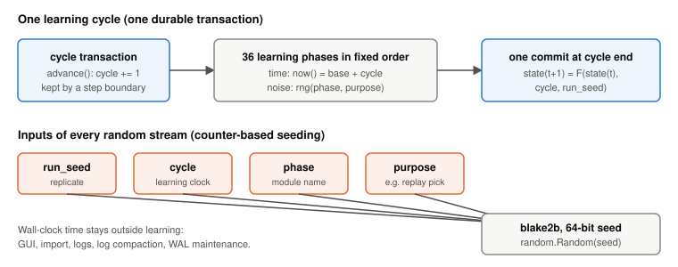
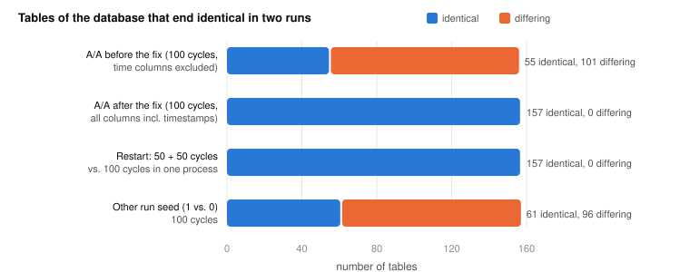
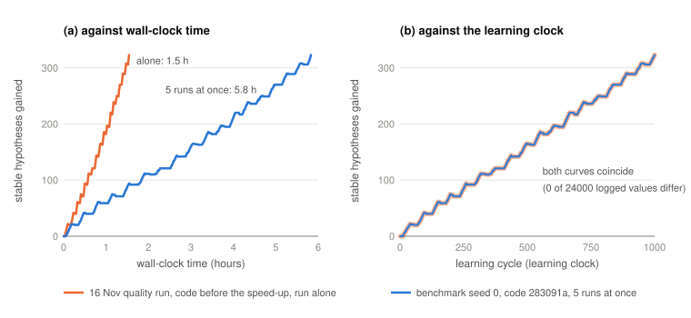
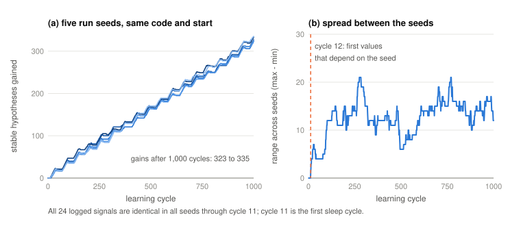
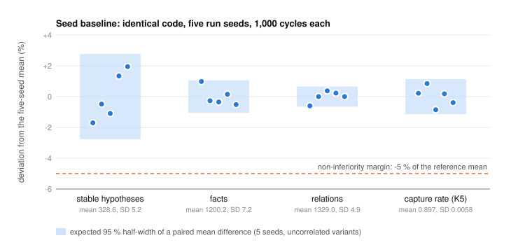
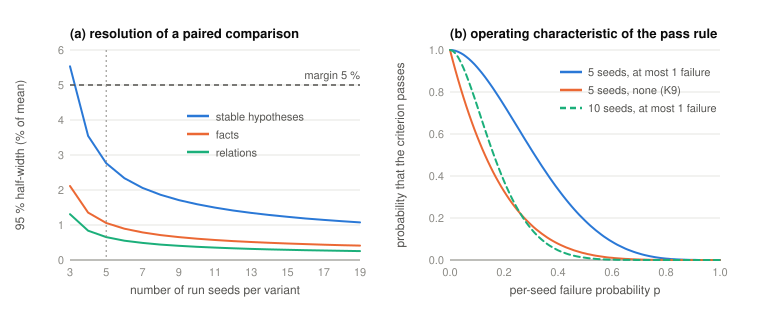
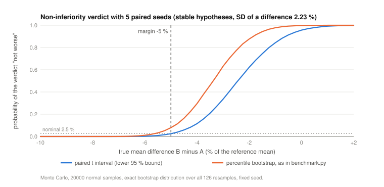

# Learning on an Experience Clock: A General Method for Repeatable and Paired Evaluation of Stochastic Learners, Demonstrated on a Biologically Inspired Text Learner

**Nick Stephan**

Draft of 17 November 2026. Preprint draft, not peer reviewed.

## Abstract

**Problem.** Stochastic learners are hard to evaluate. Random replay, sampling and state-dependent thresholds make two runs of the same code end differently. Decay and recency measured in wall-clock seconds make learning depend on the speed of the machine. A code change then cannot be separated from chance.

**Method.** We propose a general method in three parts:

1. **An experience clock.** Learning time advances by one tick per learning cycle and is stored with the learner's state. This follows evidence that forgetting depends mainly on intervening experience and that the brain builds time from events.
2. **Deterministic noise.** Every random stream is seeded from run seed, cycle, component and purpose, in the spirit of counter-based generators. Iteration and ties are totally ordered, and each cycle is atomic. A run then depends only on its start state, its code and its run seed.
3. **Seeds as replicate individuals.** Variants are compared on common seeds by paired differences against a non-inferiority margin fixed in advance.

We state the requirements as a checklist with a test for each, so the method can be applied to other learners.

**Demonstration.** We apply the method to a hard case: a biologically inspired text learner with sleep replay and consolidation.

- Before the change, two runs from identical copies differed in 101 of 156 database tables. Afterwards, all 157 tables agreed, including every timestamp, across hash salts, start times and a restart.
- Two 1,000-cycle runs that took 1.5 h and 5.8 h agreed in all 24,000 logged values.
- The spread between seed replicates was at most 1.6 %.

**Statistical check.** With five seeds, the percentile bootstrap used for the paired interval covers only 84 % instead of 95 %. It passes a variant that is exactly at the margin in 7.9 % instead of 2.5 % of cases. The paired t interval holds the nominal rate and is recommended.

**Scope.** The evidence shows repeatability on one machine and one software stack. It does not show portability.

**Keywords:** reproducibility, determinism, experience time, counter-based random numbers, common random numbers, non-inferiority, seed variance, stochastic learners, biologically inspired learning

---

## 1 Introduction

### 1.1 The problem

Many learning systems are stochastic by design. Biologically inspired ones borrow their noise from the brain:

- replay picks memories at random;
- consolidation samples among candidates;
- thresholds react to the system's own state.

This variability is part of the model, but it makes evaluation hard. If two runs of the same code end differently, a single comparison between an old and a new variant mixes the effect of the change with the effect of the run.

Deep learning shows the same problem. Identical training runs differ because of seeds, tooling and hardware (Pham et al. 2020; Summers & Dinneen 2021; Zhuang et al. 2022), and reported results often rest on too few runs (Henderson et al. 2018; Bouthillier et al. 2021).

The usual remedies fit poorly:

- **Fixing one global seed** hides the variance instead of measuring it, and it breaks as soon as any component draws one random number more than before.
- **Record and replay** (LeBlanc & Mellor-Crummey 1987) repeats one run but does not make two code variants comparable.
- **Many independent runs** are expensive when a run takes hours, and they still confound the change with the run.

Learners that model memory have a further, less obvious source of irreproducibility: **time**. A system that decays, orders or windows its memories by wall-clock seconds learns differently on a fast machine and on a slow one.

### 1.2 The method

We treat the timing and the noise of a learner as part of its stored state (Section 3):

- **An experience clock** replaces wall-clock time inside learning. It is grounded in research on forgetting and on the neural representation of time (Section 2.1).
- **Counter-based random streams, total ordering and atomic cycles** make a run a function of its start state, code and run seed.
- **Run seeds become replicate individuals.** Variants are compared on common seeds against a margin fixed in advance.

Section 3.7 turns these requirements into a checklist with a test for each.

### 1.3 What becomes possible

Once identical code gives identical results, four kinds of measurement become possible:

- a refactoring can be tested for exact equality with the old code;
- the variance between replicates can be measured exactly, and a comparison margin can be derived from it;
- a property that holds in every replicate can be told apart from an accident of a single run;
- an experiment can branch from one exact state into a perturbation arm, a sham arm and a control.

### 1.4 Demonstration and contributions

We demonstrate the method on BrainStem, a neuro-symbolic text learner. BrainStem starts without word lists, grammar or pretrained knowledge. It reads raw German Wikipedia text and runs a chain of 36 components per learning cycle, which include sleep replay, consolidation and neuromodulator-like control variables. This makes it a hard test case: noise enters in many places, and many quantities depend on time. The system is at an early developmental stage and does not understand language. It is the test bed of this paper, not its claim.

The contributions are:

1. the method and its checklist (Section 3);
2. evidence in the demonstration for repeatability, restart equivalence, independence from execution speed and genuine variation between replicates (Section 5);
3. a paired benchmark protocol with a five-seed baseline (Section 5.5);
4. an analysis of the protocol's operating characteristics, including a weakness in its interval estimate and a remedy (Section 6).

All numbers come from the project's reports and raw data, which are named next to each result. The raw data ship with the paper in `data/`. A script that needs only the Python standard library rebuilds Figures 2 to 7 and the simulation from them (`figures/make_figures.py`).

## 2 Background

### 2.1 Time in memory runs on experience

**Forgetting.** Forgetting depends more on what happens in an interval than on its length:

- Retention is better after sleep than after an equally long period awake (Jenkins & Dallenbach 1924).
- Everyday forgetting is mostly interference from later activity (Wixted 2004).
- In short-term memory, pure time-based decay fits worse than interference (Oberauer & Lewandowsky 2008; Lewandowsky, Oberauer & Brown 2009; Berman, Jonides & Lewis 2009).
- In the SIMPLE model, elapsed time matters only relative to other memories (Brown, Neath & Chater 2007).

Regulated active decay also exists (Hardt, Nader & Nadel 2013; Shuai et al. 2010). Counting time in cycles is therefore a modelling choice that the evidence supports, not a denial of time effects.

**The sense of time.** The brain builds time from experience:

- temporal context drifts with each item (Howard & Kahana 2002);
- entorhinal and hippocampal activity encode time from the structure of experience (Tsao et al. 2018; Eichenbaum 2014);
- remembered intervals follow events and similarity, not clock duration (Zacks et al. 2007; Ezzyat & Davachi 2014; Faber & Gennari 2015).

**Sleep pressure.** Sleep pressure counts hours awake in the classic two-process model (Borbély 1982). Its local component, however, follows use (Huber et al. 2004; Huber et al. 2006; Vyazovskiy et al. 2008).

### 2.2 Noise and individuality

**Noise.** Neural noise has characteristic sources and statistics (Faisal, Selen & Wolpert 2008) and may serve as sampling (Fiser et al. 2010). A seeded generator keeps the sampling distribution but is not biologically realistic.

**Individuality.** Genetically identical mice in one environment still become individuals (Freund et al. 2013; Honegger & de Bivort 2018). Robust conclusions in animal research need planned variation across replicates (Richter, Garner & Würbel 2009; Voelkl et al. 2020). We therefore treat one run seed as one individual.

### 2.3 Repeatable computation and comparison

**Reproducibility practice.** AI research often under-documents its methods (Gundersen & Kjensmo 2018). Good practice records seeds and versions (Sandve et al. 2013) and reports variance across seeds (Pineau et al. 2021).

**Hidden sources of variation in Python and SQLite:**

- Python salts string hashes, so the iteration order of sets changes between processes (Python Software Foundation, PYTHONHASHSEED).
- An unseeded `random` draws on system entropy (Python Software Foundation, random).
- SQLite guarantees no row order without `ORDER BY` (SQLite Development Team).

**Clocks and random streams:**

- Logical clocks (Lamport 1978) and discrete-event simulation (Fujimoto 1990) order events by counters and break ties deterministically.
- Counter-based and splittable generators derive streams without shared state (Salmon et al. 2011; Steele, Lea & Flood 2014).
- Stream libraries keep random numbers synchronised across compared variants (L'Ecuyer et al. 2002). Hashed seeding, however, has no proven independence guarantee (L'Ecuyer et al. 2017).
- Common random numbers reduce the variance of a difference under monotonicity conditions (Glasserman & Yao 1992; Law 2015).
- NEST gives identical results for fixed seeds and process counts (Plesser et al. 2007).

**What we can claim.** In the terms of Benureau and Rougier (2018), we reach **repeatability**, not reproducibility on other platforms.

**Testing and comparison:**

- Determinism enables differential testing, with the old implementation as a pseudo-oracle (McKeeman 1998; Barr et al. 2015).
- With few runs, the percentile bootstrap (Efron 1979) is too narrow (DiCiccio & Efron 1996; Hesterberg 2015; Colas, Sigaud & Oudeyer 2018), and intervals are preferable to point estimates (Agarwal et al. 2021).
- Non-inferiority needs a margin fixed and justified in advance (Schuirmann 1987; Lakens 2017; Lakens, Scheel & Isager 2018; Piaggio et al. 2012).
- Pre-registration separates confirmatory from exploratory analysis (Nosek et al. 2018).

## 3 The method

The method applies to any learner that works in discrete cycles. Each subsection states the general rule first and then its instance in BrainStem.

### 3.1 The learner as a discrete map

Let *S* be the complete persistent state of the learner, including its input queue. A learning cycle maps one state to the next. In a typical implementation it also reads hidden inputs:

$$S_{t+1} = F\big(S_t,\ \tau_t,\ \xi_t,\ h\big),$$

where τt is wall-clock time, ξt is entropy from unseeded or clock-seeded generators, and *h* is process-level state such as a hash salt. None of the three is part of *S*, and none is controlled by the experiment. The method removes them:

$$S_{t+1} = F\big(S_t,\ t,\ r\big) \quad\Longrightarrow\quad S_T = F^{(T)}\big(S_0;\ r\big),$$

with the cycle number *t* and the run seed *r* stored in *S*. Given a fixed software environment *E*, a run is then a function of *S0* and *r* alone.

*In BrainStem*, *S* is one SQLite database file. It also holds the input text (a chunk store and a reading queue), and *E* is the operating system with its Python and SQLite versions.

### 3.2 The experience clock

A clock stored in *S* advances by one tick per cycle, and every learning component takes its time from it:

$$\mathrm{now}(t) = b + t,$$

constant within a cycle. Decay, recency, ordering and windows therefore count cycles of experience. Wall-clock time stays outside learning, in the user interface, imports, logs and maintenance.

*In BrainStem*, the table `learning_clock` holds four values: `base`, `cycle`, `run_seed` and `step`.

- **Start value.** The base *b* is set once, to one second after the newest timestamp in the database, so learning timestamps continue the old ones in order. A fresh database starts at 1,700,000,000 (14 November 2023).
- **Tick.** The cycle transaction advances the clock at the start of each cycle and secures the tick with a step boundary, so a rollback inside a phase cannot undo it.
- **What counts cycles.** Examples are:
  - adenosine-like sleep pressure, which rises with the encoding load of each cycle;
  - a synaptic tag window of 225 to 375 cycles;
  - habituation, which counts reconfirmations;
  - a log retention of 1,000 cycles.

### 3.3 Counter-based random streams

Each random choice draws from a generator created for one component *p* and one purpose *u* in the current cycle:

$$\mathrm{seed}(r, t, p, u) = \mathrm{int}_{64}\big(\mathrm{hash}(r \,\|\, t \,\|\, p \,\|\, u)\big),\qquad G = \mathrm{PRNG}(\mathrm{seed}).$$

This follows the counter-based idea of Salmon et al. (2011): no stream depends on how many numbers another stream has consumed. Adding a random draw to one component therefore does not shift the random numbers of any other component, which keeps variants comparable under common random numbers. We have not run a statistical test suite on the derived seeds. Independence between streams is therefore expected, not proven (L'Ecuyer et al. 2017).

*In BrainStem*, the hash is blake2b and the generator is Python's Mersenne Twister. Examples of purposes are the replay pick and the critic snapshot (Figure 1).

**Figure 1.** One learning cycle in BrainStem. The cycle transaction advances the learning clock once, the 36 phases read time and randomness from it, and the cycle commits once at its end. Each random stream is seeded by a hash of run seed, cycle, phase and purpose.

### 3.4 Total order

Wherever the program iterates or sorts, the order must be total and independent of the process.

*In BrainStem* this means three things:

- sets of strings (fillers and sources of sentence frames) are iterated in sorted order;
- queries that order rows by a timestamp break ties by the row `id`;
- a comparison of the form "survival recorded after the latest revision" compares clock values, so it no longer depends on whether a wall-clock second ticks over during the cycle.

### 3.5 Atomic cycles and restart

A cycle must either take effect completely or not at all. No decision may depend on process memory that is not in *S*, unless that memory is invalidated whenever the data it summarises change. A process that stops between cycles then leaves a state from which the next cycle continues exactly as it would have in the same process. We test this property; we do not prove it (Section 5.1).

*In BrainStem*, each cycle commits once, at its end, and a commit inside a cycle only marks a savepoint. In-process caches of learned statistics carry an epoch counter that changes with every write of those statistics and with every rollback (`learning_clock.data_epoch`).

### 3.6 Replicates and paired comparison

A run seed *r* selects one replicate. Let *Y(r)* be an outcome of the run with seed *r*. Treating seeds as independent draws, *Y(r)* has a distribution over seeds. That distribution, not a single run, describes a code variant.

Two variants *A* and *B* are compared on common seeds through the paired differences *D(r) = YB(r) − YA(r)*. If *A* and *B* are the same code, then *D(r) = 0* for every seed. This is the basis of the differential tests in Section 5.6.

*In BrainStem*, `learning_clock.set_run_seed(con, n)` stores the seed in the database.

### 3.7 Applying the method to other learners

Table 1 lists the requirements, the test that checks each one, and how BrainStem meets it. A learner that passes every test can be compared with the protocol of Section 5.5.

**Table 1.** Requirements of the method and their tests.

| Requirement | Test | Instance in BrainStem |
|---|---|---|
| Complete state is persistent and includes the input position | restart test: *k* cycles, new process, *k* cycles against 2*k* cycles in one process | one SQLite file with chunk store and reading queue |
| All learning time comes from the experience clock | A/A run with shifted start time; code check for wall-clock calls in learning code (not yet automated) | `now()` from `learning_clock` in 35 phase modules and the sentence-frame module |
| All randomness comes from keyed streams | A/A run with different process salts; counter-check with another run seed | `learning_clock.rng(phase, purpose)` |
| Iteration and ties are totally ordered | A/A run with different hash salts; a run with reversed unordered queries (not yet done) | sorted sets, tie-breaking by `id` |
| Cycles are atomic, and caches follow data versions | restart test | one commit per cycle, `data_epoch` |
| The environment is recorded | manifest per run | code hash, Python 3.11.8, SQLite 3.43.1, operating system |

Learners that run nondeterministic GPU kernels need deterministic kernels as well, which can be costly (Zhuang et al. 2022). That case is outside our demonstration.

## 4 Implementation in BrainStem

A stock-taking on 16 November 2026 (report `Reproduzierbarkeit_Bestand_2026-11-16.md`) found the sources listed in Table 2.

**Table 2.** Sources of irreproducibility found in the code before the change.

| Location | Kind |
|---|---|
| Phase 6b, selection of new replay traces (`random.Random(now)`) | random generator seeded from the wall clock |
| Phase 6b, critic snapshot (`random.random()`) | global random call without a seed |
| Phase 7d, slow-wave sleep (`random.Random(now + cycle_index * 7919)`) | wall clock in the seed |
| Question-chunk feedback, global decay (`updated_at < since`) | rows selected by wall-clock seconds |
| Phases 6b and 7d (`ORDER BY last_replayed_at`, `ORDER BY updated_at`) | ties within one second depend on processor speed |
| Graduation (`s.created_at > MAX(r.created_at)`) | whether a survival in the same cycle as a revision counts depends on a second ticking over |
| Phase 5b, key `target:now` | wall clock inside stored content |
| All phases, `created_at`, `updated_at`, `last_*_at` | wall-clock timestamps in learned data |
| Sentence frames | iteration over sets of strings (hash-salt dependent) |

Some parts were already repeatable before: graduation drew from a generator seeded by the cycle number, the ontology's label propagation runs in a fixed node order, and gap habituation counts cycles.

The change was guided by the project's standing rule for open questions, an advisory council of three reviews: biology of internal time, engineering, and test procedure. It was implemented in one step (report `Reproduzierbarkeit_2026-11-16_2010.md`, commit `96242d4` of the public repository):

- a new module `learning_clock.py`;
- the clock tick in the cycle transaction;
- `now()` from the learning clock in 35 phase modules and in `semantic_evidence.py`;
- all random sources of Phases 6b, 7d and graduation drawn through `learning_clock.rng`;
- tie-breaking by `id` in the time-ordered queries of 6b and 7d;
- sorted fillers and sources in the sentence frames.

The first A/A run after the change exposed two remaining wall-clock timestamps: default values written by `Memory._init()` and `ensure_database_exists` before the clock was attached. Both now attach the clock first.

Provenance was not affected. Facts and relations still point to their source chunk and source hypothesis (`source_chunk_id`, `source_hypothesis_id`), and on the production state all 1,136 facts, 1,067 relations and 4,505 stable hypotheses trace back to their chunk (`Reproduzierbarkeit_Bestand_2026-11-16.md`).

## 5 Evaluation

All runs used copies of the production database after the second production run of 15 November 2026: 8.09 GB, 167,661 chunks, 4,505 stable hypotheses at the start. The software environment was Python 3.11.8 and SQLite 3.43.1 on Windows 10 (build 19045), as recorded in the benchmark manifest. Cycle counts are system cycles, one pass through the whole phase chain.

### 5.1 A/A runs, restart and seed counter-check

Before the change, two runs of 100 cycles from byte-identical copies, with Python hash seeds 1 and 2, differed in 101 of 156 tables. That comparison excluded time columns, since these were wall-clock values. Stable hypotheses rose from 4,505 to 4,547 in one run and to 4,541 in the other, and facts reached 1,143 and 1,140.

After the change the same test was run with hash seeds 1 and 2 and a start offset of 60 s, and this time every column was compared, including all timestamps. Only columns that record run times were excluded. All 157 tables were identical. A run of 50 cycles, a new process and another 50 cycles equalled 100 cycles in one process in all 157 tables. As a counter-check, run seed 1 instead of 0 changed 96 tables (4,545 instead of 4,546 stable hypotheses), so the seed does drive the outcome (Figure 2; report `Reproduzierbarkeit_2026-11-16_2010.md`, raw comparisons in `data/table_comparisons/`).

**Figure 2.** Tables of the database that end identical or differing in two runs of 100 cycles from byte-identical copies. Before the fix, time columns had to be excluded and still 101 tables differed. After the fix, all 157 tables agree including every timestamp, also across a restart, and a different run seed changes 96 tables.

### 5.2 Independence from execution speed

The strongest test of experience time compares two runs whose wall-clock behaviour differs widely. On 16 November 2026, a 1,000-cycle quality run was executed alone on the storage pool, with the code of the learning-clock change. One day later, seed 0 of the benchmark baseline started from the same snapshot with run seed 0, now with the code of commit `283091a`, which adds a performance change: per-cycle reuse of lexical statistics, about 0.30 s less CPU time per cycle. It ran as one of five simultaneous runs.

The two runs agreed in all 24 logged signals in all 1,000 cycles, 24,000 values in total, and in their summaries (+323 stable hypotheses, 1,212 facts, 1,321 relations, capture rate 0.899). Their wall-clock behaviour was very different: 5,551 s against 20,980 s in total, and a median of 2.9 s against 22.6 s per cycle. Most of that difference is plausibly the contention of five runs sharing one storage pool, since the code change saves only 0.3 s of CPU per cycle. We did not separate the two causes.

Against wall-clock time the two learning curves are far apart. Against the learning clock they coincide (Figure 3; data in `data/det_1000/` and `data/seed_baseline/seed_0/`, comparison computed by `figures/make_figures.py`). Under the earlier wall-clock design, the rows selected for decay and the order of tied rows depended on seconds (Table 2), so two runs at such different speeds could not have learned the same.

**Figure 3.** The same learning at very different speeds. (a) Stable hypotheses gained against wall-clock hours: the run alone took 1.5 h, the run sharing the storage pool with four others 5.8 h. (b) The same data against the learning clock: the curves coincide. None of the 24,000 logged values differ, although the two runs also used different code versions, one before and one after a performance change.

### 5.3 Learning quality before and after the change

A repeatable system is useful only if it still learns as well. Table 3 compares three 1,000-cycle runs from the same starting state. Each variant ran once, because the protocol with several seeds did not exist yet (report `Reproduzierbarkeit_2026-11-16_2010.md`). The criteria K1 to K9 are the project's calibration criteria, pre-registered on 12 November 2026. They cover the reward prediction error, neuromodulators and meta parameters at their bounds, the capture rate of tagged traces (K5), and exceptions and integrity (K9).

**Table 3.** One run per variant, 1,000 cycles from the same production copy.

| Measure | old code | sentence frames | sentence frames with learning clock |
|---|---|---|---|
| Stable hypotheses gained (graduations, K6) | +319 | +339 | +323 |
| Capture rate K5 | 0.896 | 0.898 | 0.899 |
| Facts / relations | 1,198 / 1,335 | 1,215 / 1,334 | 1,212 / 1,321 |
| Exceptions / diagnostic findings | 0 / 0 | 0 / 0 | 0 / 0 |
| Criteria K1 to K9 | all met | all met | all met |

In paired blocks of 50 cycles, the learning clock minus the old code gave +0.2 stable hypotheses per block (95 % interval −1.8 to +2.2). The clock minus the frames-only code gave −0.8 (−4.0 to +2.4). With one run per variant these intervals are wide. Before the change, two runs of the *same* code had already differed by about the same amount (+42 against +36 in 100 cycles). This is exactly the problem the protocol in Section 5.5 solves.

### 5.4 Seeds as replicates

Five run seeds of identical code (commit `283091a`), each from a fresh copy of the same snapshot, followed visibly different but closely bundled trajectories (Figure 4a). The 24 logged signals were identical in all seeds through cycle 11 and first differed in cycle 12. Cycle 11 is the first sleep cycle of the run. The seed-dependent noise therefore shows its first logged effect right after sleep replay begins, which fits the fact that most random draws (replay selection, slow-wave sampling, graduation order) belong to the sleep and consolidation phases. Seeds 0, 1 and 4 kept an identical sleep/wake sequence for all 1,000 cycles. Seeds 2 and 3 first changed state in a different cycle from seed 0 at cycle 466. The sleep share was 408 to 411 of 1,000 cycles in every seed. From cycle 50 on, the range across seeds stayed between 4 and 21 stable hypotheses, and it was 12 at cycle 1,000 (Figure 4b). The trajectories did not drift further apart over the run.

**Figure 4.** Five replicates of identical code. (a) Stable hypotheses gained per cycle for run seeds 0 to 4. (b) The range across seeds (maximum minus minimum) per cycle. All logged signals agree through cycle 11, the first sleep cycle. From cycle 50 on, the spread stays between 4 and 21 hypotheses.

Seed replication also tells robust properties from accidental ones. In all five seeds, the learning-rate signal of the system correlated with sleep pressure (r = 0.66 to 0.77) and negatively with noradrenaline (r = −0.32 to −0.41). Its correlation with the reward prediction error was near zero (−0.06 to −0.10) (report `K7_Lernrate_Fakten_2026-11-17.md`). Because the pattern held in every replicate, it was treated as a property of the code and not of one run. A second advisory council judged it biologically misdirected. That led to a redesign of the learning-rate criterion, which is described in Section 5.6.

### 5.5 The benchmark protocol and its seed baseline

The protocol (`benchmark/PROTOCOL.md`) fixes the following before any comparison run:

- the snapshot, the variants, the seeds and the cycle count;
- the criteria K1 to K9 and the non-inferiority margin.

Every variant then runs under the same conditions:

- at least five run seeds, the same seeds for both variants (common random numbers), each from a fresh copy of the snapshot, 1,000 cycles per run;
- every seed reported, then the mean, standard deviation, minimum and maximum per variant, and the paired difference per measure with a bootstrap 95 % interval;
- a criterion passes when it holds in all seeds but at most one. K9 (no exceptions, no diagnostic findings, integrity check) must hold in every seed;
- a variant is "not worse" in a measure when the lower bound of the paired interval lies above minus the margin (default 5 % of the reference mean);
- wall time is reported but never used to decide. Speed claims use CPU time, measured separately and paired;
- a manifest records the code hash, the snapshot identity, the Python and SQLite versions and the machine.

The tool's own bootstrap uses a fixed seed (`random.Random(20261116)`), so a comparison report is itself repeatable.

The first use of the tool was a seed baseline of the current code alone (commit `283091a`, seeds 0 to 4, five runs at once, 5.8 h; report `Benchmark_Basislinie_2026-11-17_0434.md`). All nine criteria held in every seed, with no exceptions and no diagnostic findings, and the integrity check passed in every run. Table 4 and Figure 5 give the spread.

**Table 4.** Seed baseline, identical code, 1,000 cycles per seed.

| Seed | Stable hypotheses gained | Facts | Relations | Capture rate K5 |
|---|---|---|---|---|
| 0 | +323 | 1,212 | 1,321 | 0.899 |
| 1 | +327 | 1,197 | 1,329 | 0.905 |
| 2 | +325 | 1,196 | 1,334 | 0.890 |
| 3 | +333 | 1,202 | 1,332 | 0.899 |
| 4 | +335 | 1,194 | 1,329 | 0.894 |
| Mean (SD) | 328.6 (5.2) | 1,200.2 (7.2) | 1,329.0 (5.0) | 0.897 (0.006) |
| Spread (SD/mean) | 1.6 % | 0.6 % | 0.4 % | 0.6 % |

**Figure 5.** Seed baseline. Dots: deviation of each seed from the five-seed mean. Shaded band: expected 95 % half-width of a paired mean difference between two variants with five seeds, if their seed-level outcomes were uncorrelated. Dashed line: the non-inferiority margin of −5 %.

From the baseline the protocol derives the expected 95 % half-width of a paired mean difference between two variants with the same spread:

$$w = t_{0.975,\,4}\cdot\sqrt{2}\cdot s/\sqrt{5} \approx 1.756\, s.$$

With the unrounded standard deviations, this gives 9.1 (2.8 %) for stable hypotheses, 12.7 (1.1 %) for facts, 8.7 (0.7 %) for relations and 0.010 (1.1 %) for the capture rate. The margin was set to 5 %, wide enough to confirm equal code reliably and narrow enough to detect a real loss of a few percent in the most variable measure. Seed 0 of the baseline reproduced the earlier quality run exactly (Section 5.2), which also checked that the tool measures the same quantities as the earlier scripts.

### 5.6 Two uses of determinism

**Differential testing of performance changes.** Because identical code now gives identical results, a performance change can be tested as a pure refactoring: old and new code run from byte-identical copies, and every table is compared. For the per-cycle reuse of lexical statistics (report `Beschleunigung_2026-11-16_2219.md`), all 157 common tables were identical after 100 cycles, including timestamps; the only new table was the one the change introduced. The same change saved 0.30 s of CPU time per cycle, measured paired over 40 cycles (95 % interval 0.26 to 0.34 s, 11 %). Before the learning clock, such an equality test was impossible, because two runs of unchanged code already differed. The test shows equivalence of two implementations. It does not show that either is correct (Barr et al. 2015).

**Counterfactual branching.** Determinism also allows experiments that branch from one exact state. The pre-registered study of an effective learning rate (`Lernrate_Wirksam_Vorabregistrierung_2026-11-17.md`, protocol amendment 1) follows this design:

- every main run saves a checkpoint after cycle 500;
- two arms continue from that checkpoint for 300 cycles: a perturbation arm that injects forced failures before ten wake cycles, and a sham arm that injects the same number of outcomes with the expected score;
- the unperturbed main run serves as the control.

All three arms share the state, the code and the run seed. Any difference between them is caused by the injected rows and their consequences. The windows, thresholds and pass rule were fixed before the first comparison run. This study was still running when this draft was written, and no results are reported here.

## 6 Statistical properties of the protocol

A three-member advisory council reviewed the protocol at our request. One member covered biology, one computing and one statistics. Its statistical findings are reported here because they change how the protocol should be used. We checked the central numbers with our own simulation, which ships with the paper (`figures/make_figures.py`, fixed seed).

**Resolution and number of seeds.** The half-width *w* above assumes that the seed-level outcomes of the two variants are uncorrelated. Under common seeds the standard deviation of a difference is

$$\sqrt{2}\,\sigma\,\sqrt{1-\rho},$$

where ρ is the correlation between the variants across seeds. With identical code and ρ = 1 it is zero. For a real change ρ is usually positive, so *w* is conservative. A small code change can still decorrelate a trajectory completely, much as the seeds diverge from cycle 12 on (Figure 4b), so ρ near 0 is plausible and *w* is a reasonable planning value.

The standard deviation itself is uncertain with four degrees of freedom: its 95 % interval runs from about 0.6 to 2.9 times the point estimate. Figure 6a shows how *w* shrinks with the number of seeds. With five seeds, stable hypotheses resolve about 2.8 %, and with ten about 1.6 %.

**The pass rule as an acceptance-sampling plan.** "All seeds but at most one" is a binomial acceptance plan with *n* = 5 and *c* = 1. If a criterion fails in a single seed with probability *p*, it passes with probability

$$(1-p)^5 + 5p(1-p)^4.$$

That is 0.92 for p = 0.1, 0.53 for p = 0.3 and 0.19 for p = 0.5 (Figure 6b). For K9 the plan is *c* = 0, and the pass probabilities are 0.59, 0.17 and 0.03. Read in the other direction, five clean runs bound the per-run exception rate only below about 45 % with 95 % confidence. K9 is a smoke test, not proof of integrity.

Requiring every criterion and every measure to pass is an intersection-union test (Berger 1982). It needs no multiplicity correction to keep its false-acceptance rate, but its power falls with each added criterion.

**Figure 6.** (a) Expected 95 % half-width of a paired mean difference, in percent of the mean, as a function of the number of seeds, using the spread of the seed baseline, together with the 5 % margin. (b) Operating characteristic of the pass rule: probability that a criterion passes as a function of its per-seed failure probability.

**The percentile bootstrap with five seeds.** The tool computes the paired interval as a percentile bootstrap over 10,000 resamples. With five values only 126 distinct resamples exist, so the bootstrap distribution is coarse and cannot extend beyond the smallest or largest observed difference. The bootstrap standard error is also smaller than the classical one by the factor √(4/5). In our simulation, which used 20,000 normal samples and evaluated the exact bootstrap distribution over all 126 resamples:

- **Coverage.** The paired *t* interval covered the true mean in 95.1 % of cases. The percentile bootstrap covered it in only 84.1 %.
- **A variant exactly at the margin** (a true loss of 5 %), using the spread of stable hypotheses, passed as "not worse" in 2.5 % of cases with the *t* bound, as intended. With the bootstrap bound it passed in 7.9 % of cases, about three times the nominal rate.
- **A true loss of 2.5 %** passed in 48 % of cases with *t* and in 77 % with the bootstrap (Figure 7).

The simulation confirms the council's independent computation (coverage 83.9 % and a false-pass rate of 8.0 %) and agrees with the known narrowness of percentile intervals in small samples (Hesterberg 2015; Colas, Sigaud & Oudeyer 2018).

**Figure 7.** Probability of the verdict "not worse" as a function of the true mean difference, five paired seeds, stable hypotheses. The paired *t* interval holds the nominal 2.5 % at the margin. The percentile bootstrap used by the tool is too permissive.

**Recommendations.** These follow from the review. None of them changes any result reported above, because the baseline involved no comparison. At the time of writing, none of them is implemented in the tool or the protocol. Until they are, every verdict of the tool, including that of the learning-rate study in Section 5.6, should be checked against the paired *t* bound computed from the reported per-seed values.

1. Use the paired *t* interval as the primary basis of the verdict and keep the bootstrap as a display. As a distribution-free check, require the smallest of the five differences to lie above minus the margin. Under independence and continuity, the smallest of five values is a one-sided 96.9 % lower bound for the median difference.
2. Report the observed correlation between variants across seeds and the standard deviation of the differences.
3. Fix the margin as an absolute number from the pre-registered baseline means rather than from the reference arm of the comparison itself, and justify it per measure by relevance, not only by noise. At 5 % the margin is 1.8 times the noise half-width for stable hypotheses but 5 to 8 times for facts and relations, so a loss of about 4 % in relations would pass.
4. Use ten seeds for decisive comparisons.
5. Archive each pre-registration under a commit hash before the first comparison run.

## 7 Discussion

**Experience time as a modelling choice.** The learning clock replaces a quantity that measured the machine (seconds) with one that measures the learner (cycles of experience). This matches the interference account of forgetting and the experience-driven representation of time in the hippocampal-entorhinal system (Section 2.1). It is also coarse. Biological experience time is continuous, contextual and partly subjective, and one tick per cycle is a discrete stand-in. A cycle in BrainStem is not a fixed amount of experience either: a wake cycle reads text, while a sleep cycle reads nothing and consolidates. Event-based clocks that tick with the number of events, as suggested by event segmentation (Zacks et al. 2007; Faber & Gennari 2015), are a possible refinement. We did not test them.

**Determinism and biology.** Organisms cannot be replayed, and some researchers see unpredictable, spontaneously varying behaviour as a basic biological trait (Brembs 2011). A deterministic model might therefore seem unbiological. Our answer is that the model is a scientific instrument. Bit-for-bit repeatability is a property of the experiment, not a claim about the organism. Biological variability is still represented, as the variance between run seeds. This is the same move as in animal research, where robust conclusions require planned variation across replicates (Richter, Garner & Würbel 2009; Voelkl et al. 2020). One seed is one individual; a claim about BrainStem must hold across individuals.

**Repeatability and provenance.** The change did not make BrainStem learn better (Table 3), and it was not meant to. Its value lies in the four kinds of measurement listed in Section 1.3, all of which appear in the case study, the last one as a pre-registered design whose results are still pending. For a project whose long-term aim is a system that neither forgets nor hallucinates, repeatability belongs to the same family as provenance. Every learned fact can be traced to its source chunk, and every learned state can now be traced to its starting state, code and seed.

**Where the noise first acts.** The first seed-dependent difference appeared in cycle 12, right after the first sleep cycle. After that, the spread between seeds stayed within a band instead of growing (Figure 4). In this system and at this developmental stage, the stochastic parts of replay therefore produce individual variation without driving the replicates apart. Whether this holds over longer runs and from earlier developmental states is untested.

## 8 Limitations

- **Repeatability, not portability.** All evidence comes from one machine with Windows 10, Python 3.11.8 and SQLite 3.43.1. Python documents limited compatibility of the `random` module across versions, SQLite may change the order of unordered queries between versions, and floating-point results can differ between platforms. We make no claim beyond the tested environment.
- **Untested paths.** Identical tables in the tested runs do not exclude nondeterminism on paths those runs did not exercise. The stock-taking report lists queries with ties and no full ordering in Phase 5c, gap detection, question feedback, the bm25 search and Phase 6a. These are repeatable on byte-identical files but not guaranteed after a `VACUUM`, which can change row order. The same applies to a rowid checkpoint in `semantic_evidence.py`. A run with `PRAGMA reverse_unordered_selects` switched on would expose dependence on implicit row order. It has not been done. An automatic check that learning modules do not call `time.time()` or the global `random` functions was listed as an open point.
- **Stream independence.** The seeds are hashes of a counter, in the spirit of Random123, not one of its tested generators. We have not run a statistical test suite on them.
- **Few seeds, one snapshot, one corpus.** The seed baseline has five seeds from one snapshot of one corpus (two Wikipedia categories) over 1,000 cycles. It measures run-seed variance only, not variance across snapshots, corpora, developmental stages or longer horizons (Bouthillier et al. 2021). The standard deviations are uncertain by a factor of about 0.6 to 2.9. Repeatability itself was shown at two horizons (100 and 1,000 cycles) but from one snapshot only. A robustness check from a second snapshot, for example an earlier developmental state after a learning reset, and over a longer horizon is the most useful next experiment. It was not run for this draft.
- **The bootstrap weakness** described in Section 6 applies to every comparison made with the current tool until the recommended change is implemented.
- **Single runs in Table 3.** The comparison of learning quality before and after the change predates the protocol and rests on one run per variant.
- **Wall-time causes not separated.** The 3.8-fold difference in wall time in Section 5.2 combines parallel load and a code change; we did not separate the two.
- **No claim about language or biology.** BrainStem is at an early developmental stage and has no language understanding. Its biological terms name mathematical state variables. This paper concerns the experimental method, not the cognitive capability.

## 9 Conclusion

A stochastic learner that cannot be repeated cannot be compared. The method proposed here makes it repeatable without removing its noise. Learning runs on an experience clock instead of seconds. Every random stream is derived from run seed, cycle, phase and purpose. Every iteration is totally ordered, and each cycle commits once. Run seeds then become replicate individuals, and variants are compared on common seeds against a margin fixed in advance.

In the BrainStem case study, this made runs identical in all 157 database tables across hash salts, start times, restarts, a refactoring and a 3.8-fold difference in wall time. It also turned seed variance into a measured quantity, from which a paired protocol was built.

The same discipline exposed a weakness in the protocol's own statistics: with five seeds the percentile bootstrap is too permissive. That weakness is now quantified and has a remedy.

The theoretical basis, that a learner's memory should run on experience rather than on seconds, is consistent with research on forgetting and on time in the brain, within the limits stated above.

## Data and code availability

- **Code.** The BrainStem code, including `ki_system/learning_clock.py`, `ki_system/v8_cycle_transaction.py` and `benchmark/`, is in the public repository `unikum-sol/brainstem`. The learning clock is in commit `96242d4`. The seed baseline ran on commit `283091a`, code hash `379c4957ef486ae3` in the benchmark manifest.
- **Data shipped with the paper.** `data/` holds unchanged copies of the per-cycle metrics and summaries of the five baseline seeds, the benchmark manifest, the 1,000-cycle quality run of 16 November 2026 and the four table-by-table comparisons (`data/README.md`).
- **Figures and simulation.** `figures/make_figures.py` rebuilds every figure and the simulation of Section 6 from `data/` with the Python standard library and writes the extracted numbers to `figures/figure_data.json`.
- **Reports.** The experiment reports cited here are kept in the project's `Audits/` folder and are not yet part of the public repository: `Reproduzierbarkeit_Bestand_2026-11-16.md`, `Reproduzierbarkeit_2026-11-16_2010.md`, `Beschleunigung_2026-11-16_2219.md`, `Benchmark_Basislinie_2026-11-17_0434.md`, `K7_Lernrate_Fakten_2026-11-17.md` and `Lernrate_Wirksam_Vorabregistrierung_2026-11-17.md`.
- **Not distributed.** The production database (8.09 GB) is derived from Wikipedia text and is not distributed.

## AI assistance

This statement describes the actual division of work.

- **Author.** BrainStem was conceived, directed and decided by the author.
- **Concept.** The concept was elaborated in conversations with ChatGPT.
- **Code.** The code was generated with Claude (Opus and Sonnet models, Anthropic) and ChatGPT, and reviewed with NotebookLM, Gemini and Copilot acting as critics.
- **Experiments and reports.** The experiments in this paper were carried out by Claude Code sessions under the author's direction, and the reports they produced are the sources cited here. This includes the learning clock, the benchmark tool, the A/A and restart tests and the seed baseline. Decisions recorded in those reports, such as the requirement that two runs from the same state must end in the same state, were the author's.
- **Manuscript.** This manuscript was drafted by Claude (Opus 5.5) in a Claude Code session from the project's code, reports and raw data. The figures and the simulation in Section 6 were produced by the same session.
- **Literature.** The literature was searched and every reference checked against publisher, DOI, PubMed, dblp or official documentation records by three Claude research agents acting as the advisory council described in Section 6.
- **Revision.** The first draft was revised after a review that the author passed on [author: name the reviewer or tool]: the abstract and introduction were refocused on the method, the background was shortened, and the raw data were bundled with the paper.
- **Review.** [To be completed by the author: statement on the author's review and approval of the final text.]

## References

Agarwal, R., Schwarzer, M., Castro, P. S., Courville, A., & Bellemare, M. G. (2021). Deep reinforcement learning at the edge of the statistical precipice. *Advances in Neural Information Processing Systems 34* (NeurIPS 2021). arXiv:2108.13264.

Barr, E. T., Harman, M., McMinn, P., Shahbaz, M., & Yoo, S. (2015). The oracle problem in software testing: A survey. *IEEE Transactions on Software Engineering*, 41(5), 507-525. https://doi.org/10.1109/TSE.2014.2372785

Benureau, F. C. Y., & Rougier, N. P. (2018). Re-run, repeat, reproduce, reuse, replicate: Transforming code into scientific contributions. *Frontiers in Neuroinformatics*, 11, 69. https://doi.org/10.3389/fninf.2017.00069

Berger, R. L. (1982). Multiparameter hypothesis testing and acceptance sampling. *Technometrics*, 24(4), 295-300.

Berman, M. G., Jonides, J., & Lewis, R. L. (2009). In search of decay in verbal short-term memory. *Journal of Experimental Psychology: Learning, Memory, and Cognition*, 35(2), 317-333. https://doi.org/10.1037/a0014873

Borbély, A. A. (1982). A two process model of sleep regulation. *Human Neurobiology*, 1(3), 195-204. PMID 7185792.

Bouthillier, X., Delaunay, P., Bronzi, M., Trofimov, A., Nichyporuk, B., Szeto, J., Sepahvand, N., Raff, E., Madan, K., Voleti, V., Kahou, S. E., Michalski, V., Arbel, T., Pal, C., Varoquaux, G., & Vincent, P. (2021). Accounting for variance in machine learning benchmarks. *Proceedings of Machine Learning and Systems*, 3. arXiv:2103.03098.

Brembs, B. (2011). Towards a scientific concept of free will as a biological trait: Spontaneous actions and decision-making in invertebrates. *Proceedings of the Royal Society B*, 278, 930-939. https://doi.org/10.1098/rspb.2010.2325

Brown, G. D. A., Neath, I., & Chater, N. (2007). A temporal ratio model of memory. *Psychological Review*, 114(3), 539-576. https://doi.org/10.1037/0033-295X.114.3.539

Colas, C., Sigaud, O., & Oudeyer, P.-Y. (2018). How many random seeds? Statistical power analysis in deep reinforcement learning experiments. arXiv:1806.08295.

DiCiccio, T. J., & Efron, B. (1996). Bootstrap confidence intervals. *Statistical Science*, 11(3), 189-228. https://doi.org/10.1214/ss/1032280214

Efron, B. (1979). Bootstrap methods: Another look at the jackknife. *The Annals of Statistics*, 7(1), 1-26. https://doi.org/10.1214/aos/1176344552

Eichenbaum, H. (2014). Time cells in the hippocampus: A new dimension for mapping memories. *Nature Reviews Neuroscience*, 15(11), 732-744. https://doi.org/10.1038/nrn3827

Ezzyat, Y., & Davachi, L. (2014). Similarity breeds proximity: Pattern similarity within and across contexts is related to later mnemonic judgments of temporal proximity. *Neuron*, 81(5), 1179-1189. https://doi.org/10.1016/j.neuron.2014.01.042

Faber, M., & Gennari, S. P. (2015). In search of lost time: Reconstructing the unfolding of events from memory. *Cognition*, 143, 193-202. https://doi.org/10.1016/j.cognition.2015.06.014

Faisal, A. A., Selen, L. P. J., & Wolpert, D. M. (2008). Noise in the nervous system. *Nature Reviews Neuroscience*, 9(4), 292-303. https://doi.org/10.1038/nrn2258

Fiser, J., Berkes, P., Orbán, G., & Lengyel, M. (2010). Statistically optimal perception and learning: From behavior to neural representations. *Trends in Cognitive Sciences*, 14(3), 119-130. https://doi.org/10.1016/j.tics.2010.01.003

Freund, J., Brandmaier, A. M., Lewejohann, L., Kirste, I., Kritzler, M., Krüger, A., Sachser, N., Lindenberger, U., & Kempermann, G. (2013). Emergence of individuality in genetically identical mice. *Science*, 340(6133), 756-759. https://doi.org/10.1126/science.1235294

Fujimoto, R. M. (1990). Parallel discrete event simulation. *Communications of the ACM*, 33(10), 30-53. https://doi.org/10.1145/84537.84545

Glasserman, P., & Yao, D. D. (1992). Some guidelines and guarantees for common random numbers. *Management Science*, 38(6), 884-908. https://doi.org/10.1287/mnsc.38.6.884

Gundersen, O. E., & Kjensmo, S. (2018). State of the art: Reproducibility in artificial intelligence. *Proceedings of the AAAI Conference on Artificial Intelligence*, 32(1), 1644-1651. https://doi.org/10.1609/aaai.v32i1.11503

Hardt, O., Nader, K., & Nadel, L. (2013). Decay happens: The role of active forgetting in memory. *Trends in Cognitive Sciences*, 17(3), 111-120. https://doi.org/10.1016/j.tics.2013.01.001

Henderson, P., Islam, R., Bachman, P., Pineau, J., Precup, D., & Meger, D. (2018). Deep reinforcement learning that matters. *Proceedings of the AAAI Conference on Artificial Intelligence*, 32(1), 3207-3214. https://doi.org/10.1609/aaai.v32i1.11694

Hesterberg, T. C. (2015). What teachers should know about the bootstrap: Resampling in the undergraduate statistics curriculum. *The American Statistician*, 69(4), 371-386. https://doi.org/10.1080/00031305.2015.1089789

Honegger, K., & de Bivort, B. (2018). Stochasticity, individuality and behavior. *Current Biology*, 28(1), R8-R12. https://doi.org/10.1016/j.cub.2017.11.058

Howard, M. W., & Kahana, M. J. (2002). A distributed representation of temporal context. *Journal of Mathematical Psychology*, 46(3), 269-299. https://doi.org/10.1006/jmps.2001.1388

Huber, R., Ghilardi, M. F., Massimini, M., Ferrarelli, F., Riedner, B. A., Peterson, M. J., & Tononi, G. (2006). Arm immobilization causes cortical plastic changes and locally decreases sleep slow wave activity. *Nature Neuroscience*, 9(9), 1169-1176. https://doi.org/10.1038/nn1758

Huber, R., Ghilardi, M. F., Massimini, M., & Tononi, G. (2004). Local sleep and learning. *Nature*, 430, 78-81. https://doi.org/10.1038/nature02663

Jenkins, J. G., & Dallenbach, K. M. (1924). Obliviscence during sleep and waking. *The American Journal of Psychology*, 35(4), 605-612. https://doi.org/10.2307/1414040

Lakens, D. (2017). Equivalence tests: A practical primer for t tests, correlations, and meta-analyses. *Social Psychological and Personality Science*, 8(4), 355-362. https://doi.org/10.1177/1948550617697177

Lakens, D., Scheel, A. M., & Isager, P. M. (2018). Equivalence testing for psychological research: A tutorial. *Advances in Methods and Practices in Psychological Science*, 1(2), 259-269. https://doi.org/10.1177/2515245918770963

Lamport, L. (1978). Time, clocks, and the ordering of events in a distributed system. *Communications of the ACM*, 21(7), 558-565. https://doi.org/10.1145/359545.359563

Law, A. M. (2015). *Simulation Modeling and Analysis* (5th ed.). McGraw-Hill Education.

LeBlanc, T. J., & Mellor-Crummey, J. M. (1987). Debugging parallel programs with Instant Replay. *IEEE Transactions on Computers*, C-36(4), 471-482. https://doi.org/10.1109/TC.1987.1676929

L'Ecuyer, P., Munger, D., Oreshkin, B., & Simard, R. (2017). Random numbers for parallel computers: Requirements and methods, with emphasis on GPUs. *Mathematics and Computers in Simulation*, 135, 3-17. https://doi.org/10.1016/j.matcom.2016.05.005

L'Ecuyer, P., Simard, R., Chen, E. J., & Kelton, W. D. (2002). An object-oriented random-number package with many long streams and substreams. *Operations Research*, 50(6), 1073-1075. https://doi.org/10.1287/opre.50.6.1073.358

Lewandowsky, S., Oberauer, K., & Brown, G. D. A. (2009). No temporal decay in verbal short-term memory. *Trends in Cognitive Sciences*, 13(3), 120-126. https://doi.org/10.1016/j.tics.2008.12.003

McKeeman, W. M. (1998). Differential testing for software. *Digital Technical Journal*, 10(1), 100-107.

Nosek, B. A., Ebersole, C. R., DeHaven, A. C., & Mellor, D. T. (2018). The preregistration revolution. *Proceedings of the National Academy of Sciences*, 115(11), 2600-2606. https://doi.org/10.1073/pnas.1708274114

Oberauer, K., & Lewandowsky, S. (2008). Forgetting in immediate serial recall: Decay, temporal distinctiveness, or interference? *Psychological Review*, 115(3), 544-576. https://doi.org/10.1037/0033-295X.115.3.544

Pham, H. V., Qian, S., Wang, J., Lutellier, T., Rosenthal, J., Tan, L., Yu, Y., & Nagappan, N. (2020). Problems and opportunities in training deep learning software systems: An analysis of variance. *Proceedings of the 35th IEEE/ACM International Conference on Automated Software Engineering*, 771-783. https://doi.org/10.1145/3324884.3416545

Piaggio, G., Elbourne, D. R., Pocock, S. J., Evans, S. J. W., Altman, D. G., & CONSORT Group (2012). Reporting of noninferiority and equivalence randomized trials: Extension of the CONSORT 2010 statement. *JAMA*, 308(24), 2594-2604. https://doi.org/10.1001/jama.2012.87802

Pineau, J., Vincent-Lamarre, P., Sinha, K., Larivière, V., Beygelzimer, A., d'Alché-Buc, F., Fox, E., & Larochelle, H. (2021). Improving reproducibility in machine learning research (a report from the NeurIPS 2019 Reproducibility Program). *Journal of Machine Learning Research*, 22(164), 1-20.

Plesser, H. E., Eppler, J. M., Morrison, A., Diesmann, M., & Gewaltig, M.-O. (2007). Efficient parallel simulation of large-scale neuronal networks on clusters of multiprocessor computers. *Euro-Par 2007 Parallel Processing*, LNCS 4641, 672-681. https://doi.org/10.1007/978-3-540-74466-5_71

Python Software Foundation. Command line and environment: PYTHONHASHSEED. https://docs.python.org/3/using/cmdline.html#envvar-PYTHONHASHSEED (accessed 17 November 2026).

Python Software Foundation. random: Generate pseudo-random numbers. https://docs.python.org/3/library/random.html (accessed 17 November 2026).

Richter, S. H., Garner, J. P., & Würbel, H. (2009). Environmental standardization: Cure or cause of poor reproducibility in animal experiments? *Nature Methods*, 6(4), 257-261. https://doi.org/10.1038/nmeth.1312

Salmon, J. K., Moraes, M. A., Dror, R. O., & Shaw, D. E. (2011). Parallel random numbers: As easy as 1, 2, 3. *Proceedings of the International Conference for High Performance Computing, Networking, Storage and Analysis (SC11)*, 1-12. https://doi.org/10.1145/2063384.2063405

Sandve, G. K., Nekrutenko, A., Taylor, J., & Hovig, E. (2013). Ten simple rules for reproducible computational research. *PLoS Computational Biology*, 9(10), e1003285. https://doi.org/10.1371/journal.pcbi.1003285

Schuirmann, D. J. (1987). A comparison of the two one-sided tests procedure and the power approach for assessing the equivalence of average bioavailability. *Journal of Pharmacokinetics and Biopharmaceutics*, 15(6), 657-680. https://doi.org/10.1007/BF01068419

Shuai, Y., Lu, B., Hu, Y., Wang, L., Sun, K., & Zhong, Y. (2010). Forgetting is regulated through Rac activity in *Drosophila*. *Cell*, 140(4), 579-589. https://doi.org/10.1016/j.cell.2009.12.044

SQLite Development Team. PRAGMA statements: reverse_unordered_selects. https://www.sqlite.org/pragma.html#pragma_reverse_unordered_selects (accessed 17 November 2026).

Steele, G. L., Jr., Lea, D., & Flood, C. H. (2014). Fast splittable pseudorandom number generators. *Proceedings of the 2014 ACM International Conference on Object Oriented Programming Systems Languages and Applications*, 453-472. https://doi.org/10.1145/2660193.2660195

Summers, C., & Dinneen, M. J. (2021). Nondeterminism and instability in neural network optimization. *Proceedings of the 38th International Conference on Machine Learning*, PMLR 139, 9913-9922.

Tsao, A., Sugar, J., Lu, L., Wang, C., Knierim, J. J., Moser, M.-B., & Moser, E. I. (2018). Integrating time from experience in the lateral entorhinal cortex. *Nature*, 561, 57-62. https://doi.org/10.1038/s41586-018-0459-6

Voelkl, B., Altman, N. S., Forsman, A., Forstmeier, W., Gurevitch, J., Jaric, I., Karp, N. A., Kas, M. J., Schielzeth, H., Van de Casteele, T., & Würbel, H. (2020). Reproducibility of animal research in light of biological variation. *Nature Reviews Neuroscience*, 21(7), 384-393. https://doi.org/10.1038/s41583-020-0313-3

Vyazovskiy, V. V., Cirelli, C., Pfister-Genskow, M., Faraguna, U., & Tononi, G. (2008). Molecular and electrophysiological evidence for net synaptic potentiation in wake and depression in sleep. *Nature Neuroscience*, 11(2), 200-208. https://doi.org/10.1038/nn2035

Wixted, J. T. (2004). The psychology and neuroscience of forgetting. *Annual Review of Psychology*, 55, 235-269. https://doi.org/10.1146/annurev.psych.55.090902.141555

Zacks, J. M., Speer, N. K., Swallow, K. M., Braver, T. S., & Reynolds, J. R. (2007). Event perception: A mind/brain perspective. *Psychological Bulletin*, 133(2), 273-293. https://doi.org/10.1037/0033-2909.133.2.273

Zhuang, D., Zhang, X., Song, S. L., & Hooker, S. (2022). Randomness in neural network training: Characterizing the impact of tooling. *Proceedings of Machine Learning and Systems* (MLSys 2022). arXiv:2106.11872.
